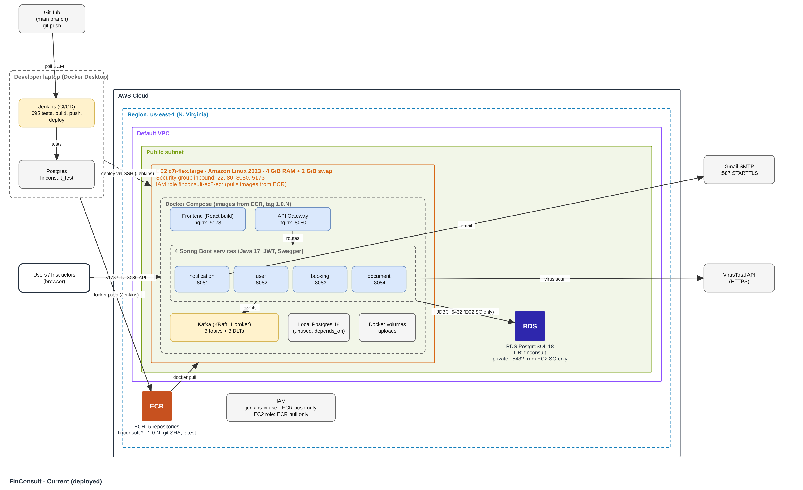
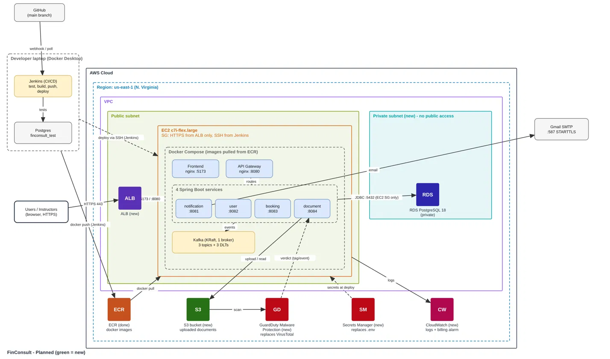
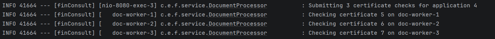
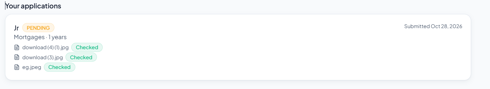
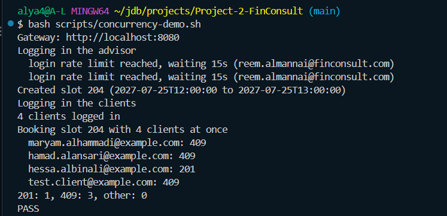
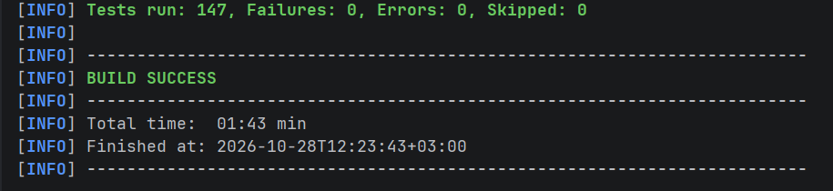
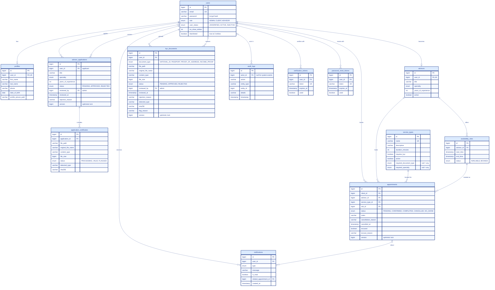
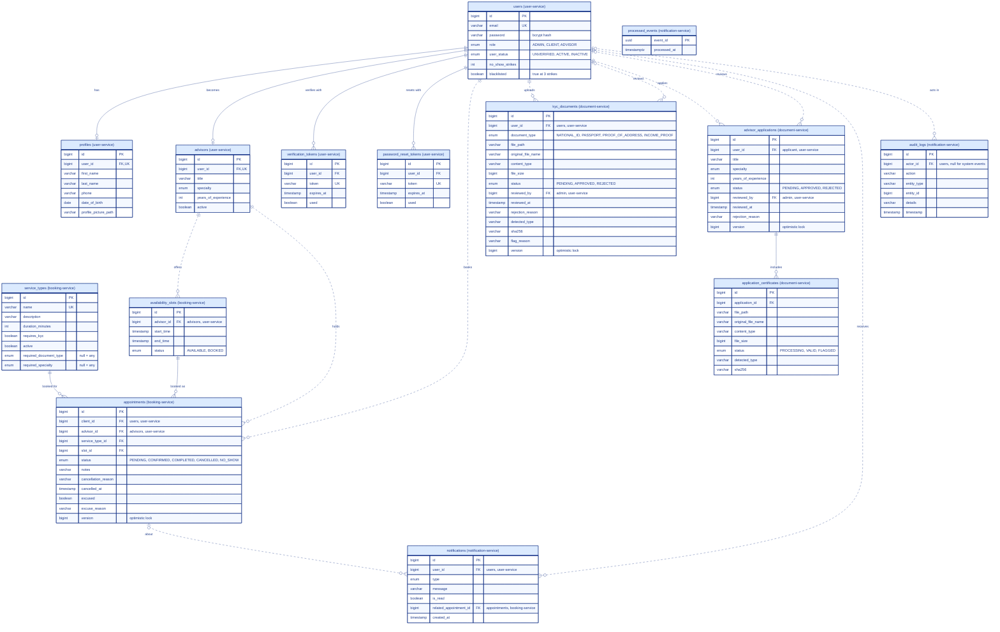

# FinConsult

## Project Information

**FinConsult** is a financial advisory platform that caters to customers, helping them make reasonable financial decisions. Clients find a financial advisor who matches what they need (loans, mortgages, investments, retirement, insurance, business banking or general advice), book an available time slot, and meet the advisor. Advisors manage their own availability and appointments, and administrators look after users, KYC documents and the audit trail.
> **Project 4:** this version splits the application into four Spring Boot microservices behind an nginx gateway, adds Kafka for asynchronous events, Docker and Docker Compose, a Jenkins CI/CD pipeline, and a deployment on AWS (EC2, RDS, ECR). See [Architecture](#architecture), [Kafka](#kafka), [CI/CD](#cicd) and [AWS](#aws).
>
> **Project 3:** added background document checks, a VirusTotal malware lookup and concurrency control for every operation two people can trigger at once. See [Project 3 Changes](#project-3-changes), [Concurrency Explanation](#concurrency-explanation) and [Testing](#testing).
>
> **Live deployment:** http://32.198.33.42:5173 (frontend). The API is reached through the gateway on port 8080. The original monolith is kept in git at the tag `monolith-final`.

### Application purpose

Booking a financial consultation normally means phone calls and back-and-forth scheduling, and services that involve moving money require identity checks first. FinConsult puts the whole flow in one secure REST API: availability, booking, identity (KYC) verification, notifications and accountability.

### Table of Contents

1. [Project Information](#project-information)
2. [Project 4 Changes](#project-4-changes)
3. [Architecture](#architecture)
4. [Services](#services)
5. [Data ownership](#data-ownership)
6. [Communication](#communication)
7. [Kafka](#kafka)
8. [CI/CD](#cicd)
9. [AWS](#aws)
10. [Deployment](#deployment)
11. [Monitoring and logging](#monitoring-and-logging)
12. [Project 3 Changes](#project-3-changes)
13. [Concurrency Explanation](#concurrency-explanation)
14. [Testing](#testing)
15. [Technologies](#technologies)
16. [General Approach](#general-approach)
17. [User Stories](#user-stories)
18. [ERD](#erd)
19. [Planning](#planning)
20. [API Documentation](#api-documentation)
21. [Installation](#installation)
22. [Unsolved Problems](#unsolved-problems)
23. [Major Challenges](#major-challenges)
24. [Future Improvements](#future-improvements)
25. [Resources](#resources)

### Main features

**Accounts & security**
* Registration with email verification (unverified users cannot log in)
* JWT login, forgot-password email and change-password (BCrypt hashed passwords)
* Three roles that really gate behaviour: `CLIENT`, `ADVISOR`, `ADMIN`
* Rate limiting on login, registration, forgot-password and reset-password (5 requests per minute per IP, `429` with `Retry-After`)
* Soft delete: admins deactivate users and advisors (`INACTIVE`), which blocks login and cancels their appointments instead of deleting rows
* User profile with profile picture upload (JPEG / PNG)

**Booking workflow**
* Advisors publish availability slots; clients book them and cannot book a slot that is already taken (no double booking)
* The advisor must match the service's required specialty (General advisors can take any service)
* Services that move money (investments, loans, mortgages, business banking) require an **approved KYC document** of the right type
* Appointment statuses with enforced transitions: a booking starts as `PENDING`, the advisor moves it to `CONFIRMED`, and it can end as `CANCELLED` or `NO_SHOW` (a cancelled or no-show appointment cannot be cancelled again)
* Cancelling less than 24 hours before the appointment adds a strike to the client; 3 strikes blacklists the client
* Advisors can mark a no-show (only after the appointment has started plus 20 minutes); admins can excuse a no-show, which recalculates the strikes
* Cancelling frees the slot again so someone else can take it, unless the appointment is less than 6 hours away (too late to be filled)
* A scheduled job closes out `CONFIRMED` appointments as `COMPLETED` once their slot has finished

**KYC**
* Clients upload identity documents (JPEG, PNG, PDF or DOCX, max 5 MB), one at a time or several at once (`POST /kyc/batch`); admins approve or reject with a reason, and can download the file
* Every document is checked in the background (Project 3): real file type, SHA-256 hash, duplicate from another account, VirusTotal malware lookup. Flagged documents show the reason to admins only

**Becoming an advisor**
* Clients can apply to become an advisor with their title, specialty, experience and one or more certificates (PDF, JPG or PNG)
* Applying requires an active, non-blacklisted client account and an **approved national ID or passport**; only one application may be pending at a time and each client gets 3 attempts in total
* Admins review the queue, download the certificates, and approve or reject with a reason; approving creates the advisor profile and switches the account's role (the applicant logs in again to pick it up)
* Certificates are checked in parallel in the background (Project 3) and marked `VALID` or `FLAGGED`; an application cannot be approved while its certificates are still being checked

**Real-time and email**
* In-app notifications for booking, confirmation, cancellation and no-show, pushed live over **Server-Sent Events**
* Live document-check updates (`KYC_CHECKED`, `CERTIFICATES_CHECKED`) and flagged-document alerts for admins (Project 3)
* Emails for verification and password recovery

**API quality**
* Filtering, sorting and pagination (see below)
* Response DTOs and a central mapper (entities and password hashes are never exposed)
* Structured error responses from a global exception handler
* Audit log of important business and admin actions
* JPA auditing (`createdAt`, `updatedAt`, `createdBy`, `updatedBy`)
* Interactive Swagger / OpenAPI documentation
* Database seeding with demo data

### Filtering, sorting and pagination

| Resource | Endpoint | Filter / sort / paging |
|---|---|---|
| Appointments | `GET /appointments/mine` | `?status=PENDING` filters by status. `?sort=field,direction` sorts, allowed fields: `createdAt`, `status`, `slot.startTime`. Defaults to `createdAt` descending |
| Advisors | `GET /advisors` | `?specialty=MORTGAGES` filters by specialty. Without it, all active advisors are returned |
| Audit logs (admin) | `GET /admin/logs` | `?action=APPOINTMENT_CANCELLED` filters by action, `?page=0&size=20` paginates |
| KYC documents (admin) | `GET /kyc` | `?status=PENDING` (default) and `?documentType=NATIONAL_ID` filter, `?page=0&size=20` paginates |

Examples:

```
GET /appointments/mine?status=CONFIRMED&sort=slot.startTime,asc
GET /advisors?specialty=INVESTMENTS
GET /admin/logs?action=ADVISOR_CREATED&page=0&size=10
GET /kyc?status=PENDING&documentType=INCOME_PROOF
```

An invalid value, for example `?status=BANANA`, returns `400 Bad Request`.

## Project 4 Changes

Project 4 keeps every feature above and changes how the application is structured, communicated, deployed and operated:

* The monolith is split into four independently runnable Spring Boot services, plus an nginx API gateway and the React frontend.
* Notifications, audit records and emails are now asynchronous Kafka events with retries, dead-letter topics and idempotent consumers.
* Everything runs in Docker containers with Docker Compose, configured through environment variables.
* Jenkins tests, builds, versions, pushes and deploys the images on every push to `main`.
* The system runs on AWS: EC2 for the containers, an RDS PostgreSQL database with no public access and ECR for the images.

## Architecture

Before: one Spring Boot application containing everything, with one process, one build and one deployment. The monolith is preserved in git at the tag `monolith-final`.

After: four independently runnable Spring Boot services behind an nginx API gateway, a React frontend, Kafka for asynchronous events and PostgreSQL for data.

```
Browser
  |
  +--> frontend (React, :5173)
  |
  +--> nginx gateway (:8080)
          |
          +--> user-service         (:8082)
          +--> booking-service      (:8083)
          +--> document-service     (:8084)
          +--> notification-service (:8081)

booking / document / user services --events--> Kafka --> notification-service
all four services --> PostgreSQL
```



*Current deployed architecture*

Production on AWS: one EC2 instance runs the containers with Docker Compose. The database is an Amazon RDS PostgreSQL instance with no public access. Images are stored in Amazon ECR. Jenkins builds, tests, pushes and deploys.

### Planned AWS architecture

The deployed system runs on one public EC2 instance. The next version moves it toward a production-grade layout (see `evidence/finconsult-architecture-planned.png`):

* **Application Load Balancer with HTTPS.** Users reach the system through an ALB with an ACM certificate. The EC2 security group then accepts traffic from the ALB only, and port 22 is limited to the deployment source.
* **Private subnet for the database.** RDS PostgreSQL moves to a private subnet with no public route, still reachable only from the application's security group.
* **S3 and GuardDuty Malware Protection.** Uploaded KYC documents and certificates go to an S3 bucket instead of the server's disk. GuardDuty scans each file inside our own AWS account, replacing the VirusTotal lookup, so personal documents never leave AWS.
* **Secrets Manager.** Database credentials, the JWT secret and API keys are read from Secrets Manager at deploy time instead of a `.env` file on the server.
* **CloudWatch.** Container logs and metrics go to CloudWatch, with alarms for failures and a billing alarm.
* **CI/CD.** Jenkins, ECR and the automated deploy already exist today. Next steps are a GitHub webhook instead of polling, and automatic rollback to the previous image tag when a deploy fails.
* **Scaling.** Run more than one instance of the stateless services behind the load balancer. Booking already handles this, because its concurrency control lives in the database. Moving the in-memory state (stream tickets, SSE connections, rate limits) to a shared store such as Redis is needed before scaling the others.



*Planned architecture (green = new)*

### Layered structure of each service

Inside every service the code keeps the layered structure from Project 2. Each layer only talks to the one below it.

```
Controller  ->  Service  ->  Repository  ->  PostgreSQL
(HTTP, DTOs)   (business rules)  (Spring Data JPA)
```

| Package | Responsibility |
|---|---|
| `controller` | REST endpoints, request validation, role checks (`@PreAuthorize`), Swagger annotations |
| `service` | All business rules: booking, cancellation and strikes, KYC, notifications, audit logging, file storage, email |
| `repository` | Spring Data JPA repositories |
| `model` | JPA entities (extend `BaseEntity` for timestamps and auditing), enums, `request` and `response` DTOs |
| `mapper` | `ResponseMapper`, the single place that converts entities to response DTOs |
| `security` | JWT filter and utilities, Spring Security configuration, rate-limit filter, auditor provider for `createdBy` / `updatedBy` |
| `exception` | Custom exceptions and the `GlobalException` handler that returns a consistent error body |
| `event` | Notification events and the listener that pushes them to SSE subscribers after the transaction commits |
| `config` | OpenAPI configuration, thread pools (`AsyncConfig`), partial unique indexes (`SchemaFixes`) and the development data seeder |

**Main entities:** `User`, `Profile`, `Advisor`, `ServiceType`, `AvailabilitySlot`, `Appointment`, `KycDocument`, `Notification`, `AuditLog`, `VerificationToken`, `PasswordResetToken`, and in Project 3 `AdvisorApplication` and `ApplicationCertificate`.

### Roles

| Role | Can do |
|---|---|
| `CLIENT` | Register, manage own profile, upload KYC, browse advisors and slots, book and cancel own appointments, receive notifications |
| `ADVISOR` | Manage own slots and details, confirm appointments, mark no-shows, cancel own appointments |
| `ADMIN` | Create advisors, deactivate users and advisors, review KYC, excuse no-shows, view audit logs |

## Services

| Service | Port | Responsibility |
|---|---|---|
| user-service | 8082 | Registration, login (issues JWTs), email verification, password reset, profiles and pictures, advisors, admin user management, no-show strikes |
| booking-service | 8083 | Service types, advisor availability slots, appointments (book, confirm, cancel, no-show, excuse), job that completes appointments |
| document-service | 8084 | KYC documents (upload, batch upload, background checks, VirusTotal lookup, approve, reject), advisor applications with certificates |
| notification-service | 8081 | In-app notifications, live browser push (SSE), audit log storage, email sending. Consumes all Kafka events |
| gateway (nginx) | 8080 | Single entry point for the API. Routes by URL path. Blocks `/internal/` |
| frontend | 5173 | React single-page application |

Per-service details: [notification-service](notification-service/README.md), [user-service](user-service/README.md), [booking-service](booking-service/README.md), [document-service](document-service/README.md). Architecture rationale: [docs/microservice-architecture.md](docs/microservice-architecture.md).

Why these boundaries: each service follows a business capability rather than a Java package. Identity, scheduling, verification documents and messaging change for different reasons and can be deployed and tested separately. Notification is a pure consumer, so the other services never wait for emails or pushes.

Each service has its own Spring Boot application, configuration, controllers, services, repositories, Dockerfile and tests. Services never import each other's Java classes.

### Gateway routing

- `/internal/` returns 404, so internal endpoints cannot be reached from outside.
- `/admin/logs` goes to notification-service; every other `/admin/` path goes to user-service.
- `/notifications/` goes to notification-service. The stream path has buffering off and a 1-hour read timeout for SSE.
- `/auth/`, `/profile/`, `/advisors`, `/uploads/profile_pictures/` go to user-service.
- `/appointments/`, `/slots`, `/service-types` go to booking-service.
- `/kyc`, `/advisor-applications` go to document-service.
- Anything else returns 404. Request body limit is 50 MB.

Config: `docker/gateway/nginx.conf`.

## Data ownership

All services share one PostgreSQL database (`finconsult`) in the `public` schema. Tables are created by `docker/db/init/01-schema.sql`; Hibernate only validates them. Each table has one owning service, and other services do not read it directly:

| Service | Tables |
|---|---|
| user-service | `users`, `profiles`, `advisors`, `verification_tokens`, `password_reset_tokens` |
| booking-service | `service_types`, `availability_slots`, `appointments` |
| document-service | `kyc_documents`, `advisor_applications`, `application_certificates` |
| notification-service | `notifications`, `audit_logs`, `processed_events` |

A service that needs data it does not own asks the owner through an internal REST endpoint or receives it in a Kafka event:

- booking-service calls user-service (user, names, strikes, advisor lookups) and document-service (approved KYC).
- document-service calls user-service (user, lookup, admins, advisor promotion).
- user-service calls booking-service (cancel appointments for a deactivated user or advisor).
- notification-service calls user-service for user lookup and gets everything else through Kafka.

Internal endpoints require the internal API key (`INTERNAL_API_KEY`) and are not routed by the gateway.

ERD: `ERD.png`.

## Communication

Synchronous (REST, request and response): client to gateway to service; service-to-service calls listed above, used only when the caller needs the answer immediately (for example, booking needs to know whether the client's KYC is approved).

Asynchronous (Kafka, fire and forget): notifications, audit records and emails. The producing service does not wait for, or depend on, the consumer. If notification-service is down, events wait in Kafka and are processed when it returns.

## Kafka

Topics are created by the `kafka-init` service in `docker-compose.yml`, each with 3 partitions and replication factor 1.

| Topic | Key | Producers | Consumer | Result |
|---|---|---|---|---|
| `notification-events` | recipient user id | booking-service and document-service (`NOTIFICATION`), document-service (`STREAM_PUSH`) | notification-service | `NOTIFICATION` saves a notification and pushes it over SSE after commit. `STREAM_PUSH` only pushes, nothing is stored |
| `audit-events` | `<entityType>:<entityId>` | user, booking and document services (`AUDIT`) | notification-service | Writes an `audit_logs` row (details cut to 800 chars) |
| `email-events` (retention 1 h) | recipient email | user-service (`EMAIL`) | notification-service | Builds the email from a template (`EMAIL_VERIFICATION`, `PASSWORD_RESET`) and sends it by SMTP |
| `*.DLT` (one per topic, `email-events.DLT` retained 24 h) | same key | notification-service dead-letter handler | none | Holds messages that failed |

Event envelope (JSON): `eventId` (UUID), `type`, `occurredAt`, `source`, `payload`.

Example `NOTIFICATION` payload: `userId`, `notificationType`, `message`, `relatedAppointmentId`.

### Reliability

- Consumer group `notification-service`; offsets start from earliest and are committed manually after handling.
- Duplicates: each `eventId` is stored in `processed_events` in the same transaction as the work, so a repeated event is skipped (idempotent consumer).
- Failures: a failed message is retried 3 times, 1 second apart, then sent unchanged to `<topic>.DLT`. A message that is not valid JSON or breaks the contract skips the retries and goes straight to the DLT.
- Producers use `acks=all` and idempotence, with a 5 second delivery timeout. In user-service, events are sent only after the database transaction commits.
- Limitation: if a send fails, the producer logs it and the user's request still succeeds, so an event can be lost (no outbox pattern). Nothing consumes the DLT topics; they are for inspection.

## CI/CD

Jenkins runs in Docker (`docker compose up -d jenkins`, http://localhost:9090). The pipeline is defined in the `Jenkinsfile` on `main`. Jenkins polls GitHub every 3 minutes, so a push to `main` starts a run automatically.

Stages:

1. Checkout from GitHub.
2. Build and test the four services (Maven). A failing build or test stops the pipeline.
3. Package the services.
4. Docker Build: one image per service plus the frontend.
5. Push to ECR: each image is tagged `1.0.<BUILD_NUMBER>`, the short git SHA and `latest`.
6. Deploy: Jenkins connects to EC2 over SSH, pulls the latest repository files, logs in to ECR, pulls the versioned images, recreates the containers (`docker-compose.prod.yml` supplies the image names) and restarts the gateway so nginx picks up the new container addresses.

Credentials are stored in Jenkins (`aws-ecr`, `ec2-host`, `ec2-ssh`) and never in the repository. The `jenkins-ci` IAM user can only push to ECR (ECR PowerUser policy).

Rollback: redeploy an earlier tag by setting `TAG` to a previous `1.0.<n>` on the EC2 instance and running the compose pull and up commands.

## AWS

| Service | Use |
|---|---|
| EC2 (c7i-flex.large, Amazon Linux 2023, us-east-1) | Runs all containers with Docker Compose |
| RDS PostgreSQL | Database. Not publicly accessible; port 5432 allows only the EC2 security group |
| ECR | Five repositories (four services and the frontend), version-tagged images |
| IAM | `jenkins-ci` user (ECR push only); EC2 instance role `finconsult-ec2-ecr` (ECR read-only pull) |
| Security groups | EC2 allows 22, 80, 8080 and 5173; RDS allows 5432 from the EC2 group only |

Security notes: the database has no public access and accepts connections only from the EC2 security group; no credentials are committed; Jenkins and EC2 use least-privilege IAM; container images are pulled with the instance role, so the instance holds no AWS keys.

## Deployment

Normal flow: push to `main`, then Jenkins does everything in the CI/CD section. No manual steps after the one-time setup.

One-time setup (already done): create the ECR repositories, the IAM user and role, the RDS instance and the EC2 instance; install Docker and Compose on EC2; clone the repository; create `.env` on the instance; add the three credentials to Jenkins.

Verify a deployment:
1. Jenkins run is green with all stages complete.
2. ECR shows the new `1.0.<n>` tag on each repository.
3. On EC2: `docker ps` shows all containers up, and `docker logs <container>` is clean.
4. Open http://32.198.33.42:5173 and log in.

## Monitoring and logging

- Container logs: `docker logs <container>` or `docker compose logs -f <service>`.
- Health: every service exposes `/actuator/health` (public inside the Docker network; the gateway does not route it). Check with `docker compose exec <service> ...` or from inside the network.
- Kafka activity: producer and consumer activity appears in the service logs; messages can be inspected with the Kafka console consumer inside the Kafka container, including the `*.DLT` topics.
- Audit trail: every important action is published to `audit-events` and stored in `audit_logs`, readable by admins at `GET /admin/logs`.
- Service failure: stopping notification-service does not break booking; events queue in Kafka and are delivered when it restarts.

## Project 3 Changes

Project 3 is the next version of the same application. It keeps the Project 2 database, JWT authentication, roles and REST API, and adds background document checks, concurrency control on every operation that two people can trigger at the same time, and live updates in the frontend.

### New functionality

* **Advisor applications with background certificate checks.** A client applies with one or more certificates. The request returns `201` straight away, and every certificate is then checked in parallel on a worker pool: the real file type is read from the file's bytes (not its extension), a SHA-256 hash is computed, duplicates are caught (the same file from another account, or twice in one application), and the hash is looked up on VirusTotal. Each certificate ends up `VALID` or `FLAGGED`, the applicant gets a live update, and admins are notified when something is flagged. An admin cannot approve while any certificate is still being checked.
* **KYC batch upload with the same checks.** `POST /kyc/batch` uploads several documents at once. Each document is checked in the background and gets a detected type, a hash and, if needed, a flag reason that only admins can see.
* **Malware check through the VirusTotal API.** Hashes are looked up on VirusTotal's public API (free tier: 4 lookups per minute). A shared limiter keeps the whole app under that limit, and repeated files are answered from a cache.

### New models

* `AdvisorApplication`: a client's request to become an advisor (title, specialty, experience, status, reviewer, rejection reason, `@Version`).
* `ApplicationCertificate`: one uploaded certificate with its check result (`PROCESSING`, `VALID` or `FLAGGED`, detected type, SHA-256).

Existing models extended for Project 3:

* `KycDocument`: `detectedType`, `sha256`, `flagReason` and `@Version`.
* `Appointment`: `excused`, `excuseReason` and `@Version`.
* `User`: `noShowStrikes` and `blacklisted` are now only changed by atomic SQL; `@DynamicUpdate` so a stale save cannot overwrite them.

### Concurrency-sensitive workflow

The main scenario is the booking workflow from Project 2, now safe under concurrent requests:

```
Available slots: 1

Client A ─┐
          ├──→ POST /appointments/book/{slotId} → row lock on the slot → one 201, one 409
Client B ─┘
```

The second scenario comes from the new code: a KYC document being checked in the background while an admin reviews it at the same moment (see [Race condition 2](#race-condition-2-background-check-vs-admin-approval)).

### Concurrency techniques used

| Technique | Where | Why |
|---|---|---|
| Pessimistic lock (`SELECT ... FOR UPDATE`) | Booking and deleting a slot, creating slots (advisor row) | The loser must wait and then see the real state |
| Optimistic lock (`@Version`) | `Appointment`, `KycDocument`, `AdvisorApplication` | Conflicts are rare, so no lock is held; a conflict returns `409` or is retried |
| Atomic SQL (`UPDATE ... RETURNING`) | Adding and removing strikes | The database does the counting, so parallel strikes are never lost |
| Partial unique indexes | One active appointment per slot, one pending application per user, one pending KYC document per type | The database itself refuses a second active row, even if a code path skips the lock |
| Thread pools (`ThreadPoolTaskExecutor`) | `docExecutor`, `mailExecutor`, `notificationExecutor` | Slow work runs in the background with bounded threads and queues |
| `CompletableFuture` | One task per file, `allOf(...).thenRun(...)`, `exceptionally(...)` | Check files in parallel and act once when all are done |
| `Semaphore` + `ScheduledExecutorService` | VirusTotal limiter | At most 4 lookups per minute across all worker threads |
| `ConcurrentHashMap`, `CopyOnWriteArrayList` | VirusTotal cache, SSE connections, rate-limit buckets | Shared in-memory state read and written by many threads |
| After-commit hooks | Starting the checks, pushing notifications | Background work only starts once the data is really saved |

### Database consistency approach

Every shared resource in FinConsult is a database row (a slot, an appointment, a document, a client's strike count), so consistency is enforced by PostgreSQL rather than by Java locks. Each business operation runs in one transaction; the row that decides the outcome is either locked (`FOR UPDATE`) or version-checked (`@Version`); counters are updated in a single SQL statement; and partial unique indexes make an impossible state (two active bookings for one slot) impossible to store. When a request loses a race it gets a `409 Conflict` and the database is left unchanged.

### Asynchronous processing

* Certificate and KYC checks run on `docExecutor` after the upload commits, so the upload request returns immediately.
* Emails are sent on `mailExecutor` (`@Async`), so a slow mail server never slows down a request.
* Notifications are pushed to SSE subscribers on `notificationExecutor` after the transaction commits.
* A scheduled job marks finished appointments as `COMPLETED`.

## Concurrency Explanation

### Race condition 1: double booking

* **Shared resource:** one `AvailabilitySlot` row.
* **Why it happens at the same time:** two clients look at the same advisor's free slots and press Book within the same moment. Each request runs on its own server thread.
* **The race:** both requests read the slot as `AVAILABLE` before either has saved anything. Both then create an appointment and mark the slot `BOOKED`.
* **Wrong result without control:** two confirmed appointments for one advisor at one time, and both clients receive `201 Created`.
* **How it is prevented:**
   1. `bookSlot` loads the slot with `findByIdForUpdate` (`SELECT ... FOR UPDATE`). The first request locks the row; the second waits.
   2. The first request creates the appointment, sets the slot to `BOOKED` and commits, which releases the lock.
   3. The second request now reads the committed row, sees `BOOKED`, and throws `SlotUnavailable`, which the global handler returns as `409 Conflict`.
   4. Backup: the partial unique index `ux_appointments_one_active_per_slot` allows only one `PENDING` or `CONFIRMED` appointment per slot, so the database refuses a second one even if a code path skipped the lock.

```
Client A                                   Client B
locks slot row (FOR UPDATE)
status AVAILABLE -> create appointment     tries to lock the same row: waits
slot = BOOKED, commit, lock released  -->  gets the lock, reads BOOKED
201 Created                                409 Conflict
```

"First" means whichever request reaches the database lock first, not who clicked first. Either way only one booking can win.

### Race condition 2: background check vs admin approval

This race lives in the new Project 3 code.

* **Shared resource:** one `KycDocument` row.
* **Why it happens at the same time:** after an upload, a worker thread checks the file (type, hash, duplicate search, VirusTotal), which takes a few seconds. During that time the document is visible to admins, and an admin can approve it.
* **The race:** the worker loaded the document while it was `PENDING`. The admin approves and commits. The worker then saves its own, older copy.
* **Wrong result without control:** the worker's save overwrites the approval (lost update), or a document the check flagged as malware stays `APPROVED`.
* **How it is prevented:**
   1. `@Version` on `KycDocument` makes the worker's stale save fail instead of overwriting the approval.
   2. `saveCheckResult` catches the conflict, reloads the latest version, copies the check result (type, hash, flag) onto it and retries, up to 3 times.
   3. If the document was approved but the check flagged it, it is sent back to `PENDING` with the reviewer cleared, so an admin has to look at it again. A clean document keeps its approval.
   4. While preparing the demo I found a second case: if the admin approves before the worker's first save, the final save has no conflict, so the document stayed approved. The check now also runs right before the final save, and a test covers this case.


### Other races handled

| Scenario | Without control | Protection |
|---|---|---|
| Client double-submits an advisor application | Two pending applications | Partial unique index, `409` |
| Two admins approve the same application | Two advisor profiles for one user | `@Version`, `409` |
| Admin approves while certificates are being checked | An application approved before its checks finished | Approve is refused while any certificate is `PROCESSING` |
| Two no-shows or excuses for one client at once | A strike lost, or removed twice | Atomic `UPDATE ... RETURNING`; `@Version` on the appointment |
| Advisor confirms while the client cancels | Slot status and appointment status disagree | `@Version` on `Appointment` |
| Two overlapping slots created at once | Overlapping availability | Advisor row lock while checking overlaps |
| Same file uploaded by two accounts in parallel | Neither upload flagged | The hash is saved first, then the duplicate check runs |
| Eight worker threads calling VirusTotal | Over the free limit (4 per minute), requests rejected | Fair `Semaphore(4)`; each permit is returned 60 seconds after it was taken |

### Why database locks and not `synchronized`

The shared state is in PostgreSQL, not in Java objects. A `synchronized` block or a `ReentrantLock` only protects one JVM: with two app instances behind a load balancer it would protect nothing, and inside one instance it would make every booking wait for every other booking, even for different slots. A row lock only blocks requests for the same slot. Pessimistic locking is used where conflicts are likely and the loser must see the real state (booking); optimistic locking is used where conflicts are rare and holding a lock would block for no reason (reviews, background checks). Java concurrency tools are used where the shared state really is in memory: the VirusTotal limiter and cache, and the SSE connections.

### Thread pools and why these sizes

| Pool | Core / max / queue | Reasoning |
|---|---|---|
| `docExecutor` (`doc-worker-`) | 4 / 8 / 30 | File checks are I/O-bound (disk read, HTTP call), so a few more threads than CPU cores helps. Capped at 8 so a large batch cannot exhaust database connections. |
| `mailExecutor` (`mail-worker-`) | 2 / 4 / 30 | Emails are few and slow; a small pool keeps SMTP from being flooded. |
| `notificationExecutor` (`notify-`) | 2 / 4 / 50 | Pushes are fast but frequent; a longer queue absorbs bursts. |

All three use `CallerRunsPolicy`: when a queue is full the caller runs the task itself, which slows the sender down instead of dropping work.



When all checks finish, the applicant's page updates live over SSE without a refresh:



### Running more than one instance (Project 4)

The protection described above lives in PostgreSQL (row locks, `@Version` checks, atomic SQL and partial unique indexes), not in Java memory, so it holds when several instances of booking-service run against the same database. Two instances behind the gateway still produce exactly one `201` and the rest `409` for the same slot.

Demo:

```bash
docker compose up -d --scale booking-service=2 --no-recreate
docker compose restart gateway      # nginx must pick up the new container address
docker compose ps                   # booking-service-1 and booking-service-2
```

Then send parallel booking requests for the same slot through the gateway (`scripts/concurrency-demo.sh`) and show with `docker compose logs booking-service` that both instances handled requests.

```bash
ADVISOR_EMAIL=... ADVISOR_PASSWORD=... CLIENT_EMAILS="..." CLIENT_PASSWORD=... SERVICE_TYPE_ID=1 bash scripts/concurrency-demo.sh
docker compose logs booking-service | grep -E "wants slot|got the lock|refused"
```

Result with four clients on one new slot, run three times: every run printed `201: 1, 409: 3, other: 0` and `PASS`. In the third run the four requests arrived within about 65 ms and were split between the two instances. The client on `booking-service-1` got the row lock first and booked the slot; the client on `booking-service-2` waited for the same lock, then saw the slot was already `BOOKED` and got `409`, like the other two:

```
booking-service-1 | Client 12 wants slot 204
booking-service-1 | Client 12 got the lock on slot 204 (status AVAILABLE)
booking-service-2 | Client 11 wants slot 204
booking-service-1 | Client 10 wants slot 204
booking-service-1 | Client 14 wants slot 204
booking-service-1 | Client 10 refused: slot 204 is already BOOKED
booking-service-2 | Client 11 refused: slot 204 is already BOOKED
booking-service-1 | Client 14 refused: slot 204 is already BOOKED
```



nginx runs one worker per CPU core and each worker rotates through the instances on its own, so a single run can land on one instance only (the first run did); repeat it to see both.

State that is kept in memory is not shared between instances of the same service: the VirusTotal limiter and cache (document-service), the rate-limit buckets (user-service), the small account-status cache (booking-service), and the live SSE connections and stream tickets (notification-service). That is why notification-service runs as a single instance. See Unsolved Problems.

## Testing

Each service has its own unit and integration tests. Integration tests load Spring, use embedded Kafka, or run Cucumber. Kafka consumer behaviour (retry, dead letter, idempotency) has dedicated tests in notification-service.

| Service | Unit | Integration | Total |
|---|---|---|---|
| notification-service | 18 | 58 | 76 |
| user-service | 38 | 97 | 135 |
| booking-service | 162 | 152 | 314 |
| document-service | 28 | 142 | 170 |
| Total | | | 695 |

**Cucumber (BDD):** `document-service/src/test/resources/features/kyc.feature` describes the KYC workflow in 5 Given/When/Then scenarios.

**Running the tests:** `cd <service> && ./mvnw test` (Windows: `mvnw.cmd test`). They need a `finconsult_test` PostgreSQL database, and only one service's tests may run at a time because they share it. The Jenkins pipeline runs the same tests and stops on any failure.

### Concurrency tests (Project 3)

In Project 3 the monolith had 39 tests (147 runs, because the race tests repeat), 22 of them concurrency tests, and they ran against a separate `finconsult_test` database so demo data was never touched. When the monolith was split, the race tests moved to the service that owns the data:

| Project 3 class | Now in |
|---|---|
| `BookingConcurrencyTest` | booking-service `AppointmentRaceTest` (two and eight clients on one slot, deleting a slot while it is booked) |
| `AppointmentConcurrencyTest` | booking-service `AppointmentRaceTest` (confirm vs cancel) and `SlotCreationRaceTest` (overlapping slots created at once) |
| `ApplicationConcurrencyTest` | document-service `ApplicationConcurrencyTest` |
| `KycConcurrencyTest` | document-service `KycConcurrencyTest` |
| `VirusTotalServiceTest` | document-service `VirusTotalServiceTest` |
| `StreamTicketServiceTest` | notification-service `StreamTicketServiceTest` |
| `RestConcurrencyTest` | not carried over as a parallel test. The same slot is protected in booking-service by the row lock and the partial unique index that `AppointmentRaceTest` exercises |
| `StrikeConcurrencyTest` | not carried over as a parallel test. Strikes now live in user-service and are counted with a single atomic SQL update; `InternalControllerTest` checks the count, the blacklist at 3 and that a removal never goes below zero, and booking-service's `NoShowConflictControllerTest` checks that a conflicting excuse removes no strike |

Each concurrency test creates its own data, starts several threads, holds them at a `CountDownLatch` and releases them at the same moment, then checks both the results (exactly one winner, the others refused) and the final database state. Race tests are repeated 5 to 20 times, because a race may only show up occasionally.

| Test class | What it proves |
|---|---|
| `BookingConcurrencyTest` | 2 and 8 clients on one slot: one booking; deleting a slot while it is booked: only one wins |
| `RestConcurrencyTest` | Two real HTTP requests to `POST /appointments/book/{slotId}`: one `201`, one `409` |
| `AppointmentConcurrencyTest` | Confirm vs cancel keeps slot and appointment consistent; overlapping slots created at once: one created |
| `StrikeConcurrencyTest` | 10 parallel strikes: none lost; blacklisted at exactly 3; a no-show excused twice at once: one strike removed |
| `ApplicationConcurrencyTest` | Double submit, two admins approving, approve vs reject, approve blocked during checks, three certificates checked on the pool |
| `KycConcurrencyTest` | Double upload, check vs approval (flagged goes back to review, clean stays approved, including the second interleaving), batch on the pool, duplicate file flagged |
| `VirusTotalServiceTest` | No key: skipped; six lookups at once: four run immediately, the fifth and sixth wait for a permit |

Project 3 run on the monolith (before the split):



More screenshots and logs are in the [evidence](evidence/) folder.

## Technologies

* Java 17
* Spring Boot 4.1.1 (embedded Tomcat)
* Spring Security + JWT (jjwt)
* Spring Data JPA / Hibernate
* PostgreSQL (Amazon RDS in production)
* Apache Kafka (KRaft mode) with Spring for Apache Kafka
* Docker and Docker Compose
* nginx (API gateway)
* Jenkins (CI/CD)
* AWS: EC2, RDS, ECR, IAM, security groups
* React with TypeScript, Vite, Tailwind and TanStack Query (frontend)
* Maven
* Bean Validation (`jakarta.validation`)
* Bucket4j (rate limiting)
* Server-Sent Events (`SseEmitter`) for real-time notifications
* Java concurrency: `ThreadPoolTaskExecutor`, `CompletableFuture`, `Semaphore`, `ScheduledExecutorService`, concurrent collections
* VirusTotal API v3 (malware lookup by file hash) through Spring's `RestClient`
* JUnit 5, Spring Boot Test, Mockito, embedded Kafka, Cucumber
* Spring Mail (SMTP), used only by notification-service
* springdoc-openapi (Swagger UI / OpenAPI)
* Lombok
* Git / GitHub

## General Approach

**Projects 2 and 3.** I started from the data model and the booking rules rather than the endpoints. The core question was how to guarantee that a slot can only be reserved once, and what must be true before a client may reserve it (an active advisor, a matching specialty, and an approved KYC document for services that involve money). Those rules live in the service layer so the controllers stay thin. Security is layered: a stateless JWT filter, role checks with `@PreAuthorize`, ownership checks in the services, response DTOs from one central mapper and one global exception handler. In Project 3 I listed every operation where two requests can touch the same row and chose a lock, a version check, an atomic update or a unique index for each, and moved slow work onto thread pools after the transaction commits.

**Project 4.** The migration went service by service. I moved one capability at a time out of the monolith into its own service and wrote additional JUnit tests for it as I went, so every step was verified before the next one began. After the services worked, I added Kafka, Docker, the Jenkins pipeline and the AWS deployment.

## User Stories

[View the user stories on Github Project](https://github.com/users/aaldaka/projects/3)

## ERD

Updated for Project 3 (`advisor_applications`, `application_certificates`, the check columns and the `version` columns). GitHub renders this diagram and lets you zoom and pan.



`users`, `profiles`, `advisors`, `advisor_applications`, `application_certificates`, `service_types`, `availability_slots`, `appointments` and `kyc_documents` also have `created_at`, `updated_at`, `created_by` and `updated_by` from `BaseEntity` (JPA auditing).

Project 4: the services share one database, and each table has one owning service (see [Data ownership](#data-ownership)). notification-service also creates a `processed_events` table (event id, used to skip duplicate events), which is not drawn above but is in the current ERD below. An image version of the ERD is in `ERD.png`.

Partial unique indexes added on startup (`SchemaFixes`) to stop races at the database level:
- `appointments (slot_id)` where status is PENDING or CONFIRMED: one active booking per slot
- `advisor_applications (user_id)` where status is PENDING: one pending application per user
- `kyc_documents (user_id, document_type)` where status is PENDING: one pending document per type

### Current ERD (after the split into services)

The tables and columns are the same as in the diagram above, because all services share one database and one schema. What changed is who owns each table (shown in brackets in each box) and how tables in different services are linked:

- Solid lines are links between tables of the same service. The service follows them itself.
- Dashed lines are links between tables of different services. The foreign key still exists in the database, but the services do not join across it: they keep only the plain id and ask the owning service through an internal REST endpoint or receive the data in a Kafka event.
- `processed_events` is new. notification-service creates it to skip events it has already handled.



## Planning

[View the project plan on Github Project](https://github.com/users/aaldaka/projects/3)

### Project 3 plan

| Day | Tasks | Status |
|---|---|---|
| 1 | Extend the data model (`AdvisorApplication`, `ApplicationCertificate`, KYC check columns); advisor application workflow and eligibility rules | Done |
| 2 | Identify shared state and race conditions (booking, strikes, reviews, uploads); booking lock and partial unique indexes | Done |
| 3 | Thread pools (`AsyncConfig`); parallel certificate and KYC checks with `CompletableFuture`; after-commit hooks | Done |
| 4 | Optimistic locking (`@Version`), atomic strike updates, `@DynamicUpdate`; blocking blacklisted users; VirusTotal integration and limiter | Done |
| 5 | Concurrency test suite (22 tests); fix the KYC check vs approval race and the second interleaving found while testing | Done |
| 6 | Real-time updates in the frontend (SSE), 401 and 409 handling; Swagger 201/409 responses; Javadoc; seed data; README and ERD | Done |
| 7 | Evidence screenshots, final test run, presentation | In progress |

### Project 4 plan

| Week | Tasks | Status |
|---|---|---|
| 1 | Identify service boundaries and data ownership; split the monolith into the four microservices one service at a time, with internal REST calls and additional JUnit tests at each step | Done |
| 2 | Kafka events (producers, consumers, retry, dead-letter topics), Docker and Docker Compose, nginx gateway, Jenkins CI/CD pipeline with versioned images in ECR, AWS deployment (EC2, RDS, ECR, IAM, security groups), monitoring, documentation and presentation | Done |

## API Documentation

Interactive documentation is generated with Swagger / OpenAPI for each service. With the stack running, through the gateway:

* Notification service: http://localhost:8080/notification-api/
* User service: http://localhost:8080/user-api/
* Booking service: http://localhost:8080/booking-api/
* Document service: http://localhost:8080/document-api/

Each address redirects to that service's Swagger UI. To try protected endpoints: call `POST /auth/login`, copy the `token` from the response, click **Authorize** and paste the token (without the word `Bearer`).

Endpoints under `/internal/` are service-to-service only. They need the internal API key and the gateway returns 404 for them.

Kafka events are documented in the [Kafka](#kafka) section, separately from the REST API.

### Endpoint reference

| Request Type | URL | Functionality | Access |
|---|---|---|---|
| POST | `/auth/register` | Register a new client account | Public |
| GET | `/auth/verify-email?token=` | Verify email address | Public |
| POST | `/auth/login` | Log in and receive a JWT | Public |
| POST | `/auth/forget-password` | Request a password reset email | Public |
| POST | `/auth/reset-password` | Set a new password using the emailed reset token | Public |
| POST | `/auth/change-password` | Change own password | Private |
| GET | `/service-types` | List the available consultation services | Private |
| GET | `/profile/me` | Get own profile | Private |
| PATCH | `/profile/me` | Update own profile | Private |
| POST | `/profile/me/picture` | Upload or replace profile picture | Private |
| GET | `/advisors` | List active advisors (`?specialty=`) | Private |
| GET | `/advisors/{id}` | Get an advisor | Private |
| PATCH | `/advisors/me` | Update own advisor details | Advisor |
| GET | `/slots/advisor/{advisorId}` | List an advisor's available slots | Private |
| GET | `/slots/mine` | List own slots | Advisor |
| POST | `/slots` | Create an availability slot | Advisor |
| DELETE | `/slots/{id}` | Delete an unbooked slot | Advisor |
| POST | `/appointments/book/{slotId}` | Book a slot for a service type (`201`, or `409` if someone else booked it first) | Client |
| GET | `/appointments/mine` | List own appointments (`?status=`, `?sort=`) | Private |
| PATCH | `/appointments/{id}/confirm` | Confirm a pending appointment | Advisor |
| PATCH | `/appointments/{id}/cancel` | Cancel an appointment (late cancel adds a strike) | Private (appointment parties) |
| PATCH | `/appointments/{id}/no-show` | Mark the client as a no-show | Advisor |
| PATCH | `/appointments/{id}/excuse` | Excuse a no-show and recalculate strikes | Admin |
| GET | `/appointments/no-shows` | List no-show appointments (excused ones included) | Admin |
| POST | `/kyc` | Upload a KYC document | Client |
| POST | `/kyc/batch` | Upload several KYC documents at once (Project 3) | Client |
| PUT | `/kyc/{id}/file` | Upload a new file for own document; it goes back to pending review and is checked again | Client |
| GET | `/kyc/me` | List own KYC documents | Client |
| GET | `/kyc` | List KYC documents (`?status=`, `?documentType=`, `?page=`, `?size=`) | Admin |
| PATCH | `/kyc/{id}/approve` | Approve a KYC document | Admin |
| PATCH | `/kyc/{id}/reject` | Reject a KYC document with a reason | Admin |
| GET | `/kyc/{id}/download` | Download a KYC document file | Admin |
| POST | `/advisor-applications` | Apply to become an advisor (details + certificate files) | Client |
| GET | `/advisor-applications/mine` | List own applications and attempts used | Client |
| GET | `/advisor-applications` | List applications (`?status=`, `?page=`, `?size=`) | Admin |
| PATCH | `/advisor-applications/{id}/approve` | Approve an application and promote the applicant | Admin |
| PATCH | `/advisor-applications/{id}/reject` | Reject an application with a reason | Admin |
| GET | `/advisor-applications/certificates/{certificateId}/download` | Download a certificate file | Admin |
| PUT | `/advisor-applications/certificates/{certificateId}/file` | Upload a new file for a certificate of own pending application; it is checked again | Client |
| GET | `/notifications/mine` | List own notifications | Private |
| GET | `/notifications/mine/unread` | List own unread notifications | Private |
| PATCH | `/notifications/{id}/read` | Mark a notification as read | Private |
| PATCH | `/notifications/mine/read-all` | Mark all own notifications as read | Private |
| POST | `/notifications/stream-ticket` | Get a single-use ticket (valid 30 seconds) to open the stream | Private |
| GET | `/notifications/stream?ticket=` | Subscribe to real-time notifications (SSE) with that ticket | Ticket |
| POST | `/admin/advisors` | Create an advisor account | Admin |
| GET | `/admin/clients` | List clients that are not deactivated (for the deactivate picker) | Admin |
| PATCH | `/admin/users/{id}/deactivate` | Deactivate a user and cancel their appointments | Admin |
| PATCH | `/admin/advisors/{id}/deactivate` | Deactivate an advisor (reason required) | Admin |
| GET | `/admin/logs` | List audit logs (`?action=`, `?page=`, `?size=`) | Admin |

"Private" means any logged-in user with a valid JWT.

### Project 3 API changes

* **New endpoint:** `POST /kyc/batch` (several files with one document type each).
* **New response fields:** `KycDocResponse` has `detectedType` and `flagged` (and `flagReason` for admins only); `CertificateResponse` has `status` and `detectedType`.
* **Status codes:** booking and slot creation return `201 Created`. Every operation that can lose a race documents `409 Conflict`: booking, application submit/approve/reject, KYC upload/approve/reject, and appointment confirm/cancel/no-show/excuse.
* **New rules:** approving an application while a certificate is `PROCESSING` returns `400`; requests from blacklisted or deactivated users are no longer authenticated, so they are rejected on their next request, even with a valid token.
* **SSE:** the browser's `EventSource` cannot send an `Authorization` header, and a JWT in the URL would end up in logs and history. So the client calls `POST /notifications/stream-ticket` with its JWT and opens `/notifications/stream?ticket=...` with the returned ticket. A ticket is random (32 bytes), works once and expires after 30 seconds, so every reconnect asks for a new one. The stream no longer accepts `?token=`.

### Error responses

Errors share one structure.

```json
{
  "timestamp": "2026-10-07T14:56:30",
  "status": 404,
  "error": "NOT_FOUND",
  "message": "Appointment not found",
  "path": "/appointments/42/confirm"
}
```

## Installation

**Requirements:** Docker with Compose. No Java, Node or PostgreSQL install is needed to run the system.

1. **Clone the repository**
   ```bash
   git clone https://github.com/aaldaka/FinConsult.git
   cd FinConsult
   ```
2. **Create your `.env`** from the example and fill in the values. Never commit it.
   ```bash
   cp .env.example .env
   ```
3. **Start everything**
   ```bash
   docker compose up -d --build
   ```
   This starts PostgreSQL (initialised from `docker/db/init`), Kafka with its topics, the four services, the gateway and the frontend. Services reach each other by Docker network name, not localhost. With the `dev` seed data the demo accounts below exist.
4. **Open the app**
   * Frontend: http://localhost:5173
   * API through the gateway: http://localhost:8080
   * Swagger UIs: see [API Documentation](#api-documentation)
5. **Stop everything:** `docker compose down`

Build one service image: `docker compose build booking-service`. Run one service's tests: see [Testing](#testing).

### Environment variables

No values are committed. Names only. Copy `.env.example` to `.env`.

Compose-level: `POSTGRES_DB`, `POSTGRES_HOST_PORT`, `DB_URL`, `DB_USERNAME`, `DB_PASSWORD`, `JWT_SECRET`, `JWT_EXPIRATION_MS`, `INTERNAL_API_KEY`, `APP_FRONTEND_URL`, `CORS_ALLOWED_ORIGINS`, `VITE_API_URL`, `MULTIPART_MAX_FILE_SIZE`, `MULTIPART_MAX_REQUEST_SIZE`, `MAIL_HOST`, `MAIL_PORT`, `MAIL_USERNAME`, `MAIL_PASSWORD`, `VIRUSTOTAL_API_KEY`, `KYC_CHECK_DELAY_MS`. The production override also uses `REGISTRY` and `TAG`.

All services read: `SPRING_DATASOURCE_URL`, `SPRING_DATASOURCE_USERNAME`, `SPRING_DATASOURCE_PASSWORD`, `JWT_SECRET`, `CORS_ALLOWED_ORIGINS`, `SERVER_PORT`, `SPRING_KAFKA_BOOTSTRAP_SERVERS`, `INTERNAL_API_KEY`.

Per service:
- notification-service: `USER_SERVICE_URL`, `SPRING_MAIL_*`
- user-service: `BOOKING_SERVICE_URL`, `JWT_EXPIRATIONMS`, `APP_UPLOAD_DIR`, `APP_FRONTEND_URL`
- booking-service: `USER_SERVICE_URL`, `DOCUMENT_SERVICE_URL`
- document-service: `USER_SERVICE_URL`, `APP_UPLOAD_DIR`, `VIRUSTOTAL_API_KEY`, `KYC_CHECK_DELAY_MS`

`VITE_API_URL` is baked into the frontend at image build time, so changing the API address means rebuilding the frontend image. In production the secrets live in a `.env` on the EC2 instance (not in git) and the AWS keys live in Jenkins credentials.

The Jenkins container is started separately with `docker compose up -d jenkins` and is available at http://localhost:9090.

### Demo accounts (development only)

All seeded accounts use the password `Password123!`.

| Role | Email |
|---|---|
| Admin | `abdulaziz.alkhalifa@finconsult.com` |
| Advisor (Investments) | `nasser.alkooheji@finconsult.com` |
| Advisor (General) | `reem.almannai@finconsult.com` |
| Client (KYC approved) | `maryam.alhammadi@example.com` |
| Client (rejected advisor application) | `hamad.alansari@example.com` |
| Client (advisor application ready to approve) | `hessa.albinali@example.com` |
| Client (flagged certificate and KYC document) | `salman.alderazi@example.com` |

## Unsolved Problems

* **State held in memory per instance.** Stream tickets, live SSE connections, rate-limit buckets, the VirusTotal cache and limiter and the account-status cache are not shared between instances. A shared store such as Redis would fix this.
* **Events can be lost.** Producers log and continue if a send fails (no outbox pattern), and nothing consumes the dead-letter topics; they are for manual inspection.
* **Uploaded files are stored in Docker volumes on the server.** A production setup would use object storage such as S3.
* **Health endpoints are internal only.** `/actuator/health` exists on every service but is not exposed outside the Docker network, and no compose healthcheck uses it.
* **Privacy of personal documents.** KYC documents and certificates contain personal data and must never be uploaded to a public scanner like VirusTotal, so the app only sends each file's SHA-256 hash. A safer production option is AWS GuardDuty Malware Protection for S3.

## Major Challenges

* **Preventing double booking and keeping slots consistent.** A booking has to reserve the slot and create the appointment together, and a cancellation has to release the slot again. Both run in a single transaction in the service layer, and a slot's status is checked before it is booked.

* **Entities leaked through the API.** Early endpoints returned entities, which exposed internal fields. I introduced response DTOs and one central mapper so every service returns the same safe shapes.
* **Project 3: understanding threads and where concurrency applies.** At first I thought about concurrency as "add threads". Each HTTP request already runs on its own server thread, so the real question was which of those requests can touch the same data at the same time. I went through every operation and asked what two people could do to the same row at once (book the same slot, review the same document, add strikes to the same client), and only then chose a lock, a version check or a database constraint for each. Thread pools came last, for work that is slow and does not need to block the user, like checking uploaded files.
* **Project 3: the KYC check racing an admin approval.** The background check could overwrite an approval or leave a flagged file approved. `@Version` turned the overwrite into a conflict, and a retry that merges the check result fixed it. While preparing the demo I found a second order of events the first fix missed (approval before the hash save), wrote a test that reproduced it, and fixed it.
* **Project 3: rate limit vs concurrency limit.** A semaphore released when the VirusTotal call finished still allowed more than 4 calls per minute. Each permit is now returned 60 seconds after it was taken, by a scheduler thread.
* **Project 4: splitting a monolith with a shared database.** Deciding which service owns each table and replacing direct repository calls with internal REST calls and Kafka events.
* **Project 4: configuration per environment.** The frontend API address is fixed at build time and the CORS origin was hard-coded, which caused "cannot reach the server" and 403 errors on AWS until both became environment variables.
* **Project 4: nginx caching container addresses.** Recreating a service container gave it a new IP and the gateway returned 502 until it was restarted. The deploy stage now restarts the gateway.
* **Project 4: giving Jenkins Docker, AWS and SSH access.** Jenkins runs in a container with the host Docker socket, the AWS CLI and an SSH client, plus git `safe.directory` configuration and separate credential IDs and secrets.
* **Project 4: locking down AWS.** Moving RDS to private access with only the EC2 security group allowed, and least-privilege IAM for Jenkins (ECR push only) and for EC2 (ECR pull only).
* **Project 4: an unstable network** caused failed package downloads and ECR push timeouts; retries and re-runs resolved them.

## Future Improvements

* Major banks and other entities as clients
* Payment gateway for paid consultations
* AI assistant to help with inquiries. If a general advisor is unavailable, the assistant steps in. It detects sensitive information such as salary or ID numbers and does not save the session data
* Cleaner code approach when it comes to separation of concerns
* Group sessions and webinars
* Video consultations
* Smart matching: the client answers a few questions (goal, budget, urgency) and the app suggests the best advisors.
* Application Load Balancer with HTTPS (ACM certificate), and RDS moved to a private subnet
* Replace the VirusTotal lookup with S3 upload plus GuardDuty Malware Protection
* AWS Secrets Manager for secrets and CloudWatch for logs, metrics and alarms
* Separate schemas or databases per service, and the outbox pattern for events
* Compose or ECS healthchecks and automatic rollback on a failed deploy
* Consumers for the dead-letter topics, with alerting
* ECS or Kubernetes with autoscaling and rolling deployments
* Spring Cloud Gateway with central JWT validation and rate limiting
* More Cucumber coverage across services and Kafka flows

## Resources

| Resource | URL | Used for |
|---|---|---|
| Baeldung: Rate Limiting with Bucket4j | https://www.baeldung.com/spring-bucket4j | Rate limiting on public endpoints |
| Baeldung: Server-Sent Events in Spring | https://www.baeldung.com/spring-server-sent-events | Real-time notifications |
| Spring Data `PageRequest` API docs | https://docs.spring.io/spring-data/commons/docs/current/api/org/springframework/data/domain/PageRequest.html | Pagination |
| Baeldung: Sorting with Spring Data | https://www.baeldung.com/spring-data-sorting | Sorting |
| springdoc-openapi | https://springdoc.org | Swagger / OpenAPI documentation |
| ByteByteGo: Pessimistic vs Optimistic Locking | https://bytebytego.com/guides/pessimistic-vs-optimistic-locking/ | Choosing between row locks and version checks (Project 3) |
| Baeldung: Guide to ExecutorService vs. CompletableFuture | https://www.baeldung.com/java-executorservice-vs-completablefuture | Running the document checks in parallel and combining the results (Project 3) |
| Spring Framework: Task Execution and Scheduling | https://docs.spring.io/spring-framework/reference/integration/scheduling.html | `@Async`, `ThreadPoolTaskExecutor` and `@Scheduled` (Project 3) |
| Baeldung: CompletableFuture and ThreadPool in Java | https://www.baeldung.com/java-completablefuture-threadpool | Running `CompletableFuture` tasks on a custom thread pool (Project 3) |
| GeeksforGeeks: Hibernate @Version Annotation with Example | https://www.geeksforgeeks.org/?p=1021984 | Optimistic locking with `@Version` (Project 3) |
| Spring Framework: SimpleClientHttpRequestFactory API | https://docs.spring.io/spring-framework/docs/current/javadoc-api/org/springframework/http/client/SimpleClientHttpRequestFactory.html | Connect and read timeouts for the VirusTotal client (Project 3) |
| VirusTotal API: Get a file report | https://docs.virustotal.com/reference/file-info | Looking up a file by its SHA-256 hash (Project 3) |
| VirusTotal | https://www.virustotal.com | API key and free-tier limits (Project 3) |
| Docker documentation | https://docs.docker.com | Dockerfiles, Compose, networking (Project 4) |
| Spring Boot reference | https://docs.spring.io/spring-boot/ | Configuration, actuator, security (Project 4) |
| Spring for Apache Kafka | https://docs.spring.io/spring-kafka/ | Producers, consumers, retry, dead letters (Project 4) |
| Apache Kafka documentation | https://kafka.apache.org/documentation/ | Topics, partitions, KRaft (Project 4) |
| Jenkins documentation | https://www.jenkins.io/doc/ | Pipeline, credentials, SCM polling (Project 4) |
| Amazon ECR documentation | https://docs.aws.amazon.com/AmazonECR/ | Repositories and authentication (Project 4) |
| Amazon EC2 and RDS documentation | https://docs.aws.amazon.com/ | Instances, security groups, RDS without public access (Project 4) |
| AWS IAM documentation | https://docs.aws.amazon.com/IAM/ | Users, roles, least privilege (Project 4) |
| nginx documentation | https://nginx.org/en/docs/ | Reverse proxy and routing (Project 4) |
| Cucumber documentation | https://cucumber.io/docs/ | BDD scenarios (Project 4) |

Thanks to the instructors and my classmates who helped along AWS Deployment and Jenkins!