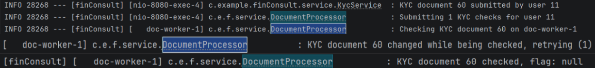

# FinConsult

## Project Information

**FinConsult** is a financial advisory platform that caters to customers, helping them make reasonable financial decisions. Clients find a financial advisor who matches what they need (loans, mortgages, investments, retirement, insurance, business banking or general advice), book an available time slot, and meet the advisor. Advisors manage their own availability and appointments, and administrators look after users, KYC documents and the audit trail.

> **Project 3:** this version adds background document checks, a VirusTotal malware lookup and concurrency control for every operation two people can trigger at once. See [Project 3 Changes](#project-3-changes), [Concurrency Explanation](#concurrency-explanation) and [Testing](#testing).

### Application purpose

Booking a financial consultation normally means phone calls and back-and-forth scheduling, and services that involve moving money require identity checks first. FinConsult puts the whole flow in one secure REST API: availability, booking, identity (KYC) verification, notifications and accountability.

### Main features

**Accounts & security**
* Registration with email verification (unverified users cannot log in)
* JWT login, forgot-password email and change-password (BCrypt hashed passwords)
* Three roles that really gate behaviour: `CLIENT`, `ADVISOR`, `ADMIN`
* Rate limiting on login, registration, forgot-password and reset-password (5 requests per minute per IP, `429` with `Retry-After`)
* Soft delete: admins deactivate users and advisors (`INACTIVE`), which blocks login and cancels their appointments instead of deleting rows
* User profile with profile picture upload (JPEG / PNG)

**Booking workflow**
* Advisors publish availability slots; clients book them and cannot book a slot that is already taken (no double booking)
* The advisor must match the service's required specialty (General advisors can take any service)
* Services that move money (investments, loans, mortgages, business banking) require an **approved KYC document** of the right type
* Appointment statuses with enforced transitions: a booking starts as `PENDING`, the advisor moves it to `CONFIRMED`, and it can end as `CANCELLED` or `NO_SHOW` (a cancelled or no-show appointment cannot be cancelled again)
* Cancelling less than 24 hours before the appointment adds a strike to the client; 3 strikes blacklists the client
* Advisors can mark a no-show (only after the appointment has started plus 20 minutes); admins can excuse a no-show, which recalculates the strikes
* Cancelling frees the slot again so someone else can take it, unless the appointment is less than 6 hours away (too late to be filled)
* A scheduled job closes out `CONFIRMED` appointments as `COMPLETED` once their slot has finished

**KYC**
* Clients upload identity documents (JPEG, PNG, PDF or DOCX, max 5 MB), one at a time or several at once (`POST /kyc/batch`); admins approve or reject with a reason, and can download the file
* Every document is checked in the background (Project 3): real file type, SHA-256 hash, duplicate from another account, VirusTotal malware lookup. Flagged documents show the reason to admins only

**Becoming an advisor**
* Clients can apply to become an advisor with their title, specialty, experience and one or more certificates (PDF, JPG or PNG)
* Applying requires an active, non-blacklisted client account and an **approved national ID or passport**; only one application may be pending at a time and each client gets 3 attempts in total
* Admins review the queue, download the certificates, and approve or reject with a reason; approving creates the advisor profile and switches the account's role (the applicant logs in again to pick it up)
* Certificates are checked in parallel in the background (Project 3) and marked `VALID` or `FLAGGED`; an application cannot be approved while its certificates are still being checked

**Real-time and email**
* In-app notifications for booking, confirmation, cancellation and no-show, pushed live over **Server-Sent Events**
* Live document-check updates (`KYC_CHECKED`, `CERTIFICATES_CHECKED`) and flagged-document alerts for admins (Project 3)
* Emails for verification and password recovery

**API quality**
* Filtering, sorting and pagination (see below)
* Response DTOs and a central mapper (entities and password hashes are never exposed)
* Structured error responses from a global exception handler
* Audit log of important business and admin actions
* JPA auditing (`createdAt`, `updatedAt`, `createdBy`, `updatedBy`)
* Interactive Swagger / OpenAPI documentation
* Database seeding with demo data

### Filtering, sorting and pagination

| Resource | Endpoint | Filter / sort / paging |
|---|---|---|
| Appointments | `GET /appointments/mine` | `?status=PENDING` filters by status. `?sort=field,direction` sorts, allowed fields: `createdAt`, `status`, `slot.startTime`. Defaults to `createdAt` descending |
| Advisors | `GET /advisors` | `?specialty=MORTGAGES` filters by specialty. Without it, all active advisors are returned |
| Audit logs (admin) | `GET /admin/logs` | `?action=APPOINTMENT_CANCELLED` filters by action, `?page=0&size=20` paginates |
| KYC documents (admin) | `GET /kyc` | `?status=PENDING` (default) and `?documentType=NATIONAL_ID` filter, `?page=0&size=20` paginates |

Examples:

```
GET /appointments/mine?status=CONFIRMED&sort=slot.startTime,asc
GET /advisors?specialty=INVESTMENTS
GET /admin/logs?action=ADVISOR_CREATED&page=0&size=10
GET /kyc?status=PENDING&documentType=INCOME_PROOF
```

An invalid value, for example `?status=BANANA`, returns `400 Bad Request`.

## Project 3 Changes

Project 3 is the next version of the same application. It keeps the Project 2 database, JWT authentication, roles and REST API, and adds background document checks, concurrency control on every operation that two people can trigger at the same time, and live updates in the frontend.

### New functionality

* **Advisor applications with background certificate checks.** A client applies with one or more certificates. The request returns `201` straight away, and every certificate is then checked in parallel on a worker pool: the real file type is read from the file's bytes (not its extension), a SHA-256 hash is computed, duplicates are caught (the same file from another account, or twice in one application), and the hash is looked up on VirusTotal. Each certificate ends up `VALID` or `FLAGGED`, the applicant gets a live update, and admins are notified when something is flagged. An admin cannot approve while any certificate is still being checked.
* **KYC batch upload with the same checks.** `POST /kyc/batch` uploads several documents at once. Each document is checked in the background and gets a detected type, a hash and, if needed, a flag reason that only admins can see.
* **Malware check through the VirusTotal API.** Hashes are looked up on VirusTotal's public API (free tier: 4 lookups per minute). A shared limiter keeps the whole app under that limit, and repeated files are answered from a cache.

### New models

* `AdvisorApplication`: a client's request to become an advisor (title, specialty, experience, status, reviewer, rejection reason, `@Version`).
* `ApplicationCertificate`: one uploaded certificate with its check result (`PROCESSING`, `VALID` or `FLAGGED`, detected type, SHA-256).

Existing models extended for Project 3:

* `KycDocument`: `detectedType`, `sha256`, `flagReason` and `@Version`.
* `Appointment`: `excused`, `excuseReason` and `@Version`.
* `User`: `noShowStrikes` and `blacklisted` are now only changed by atomic SQL; `@DynamicUpdate` so a stale save cannot overwrite them.

### Concurrency-sensitive workflow

The main scenario is the booking workflow from Project 2, now safe under concurrent requests:

```
Available slots: 1

Client A ─┐
          ├──→ POST /appointments/book/{slotId} → row lock on the slot → one 201, one 409
Client B ─┘
```

The second scenario comes from the new code: a KYC document being checked in the background while an admin reviews it at the same moment (see [Race condition 2](#race-condition-2-background-check-vs-admin-approval)).

### Concurrency techniques used

| Technique | Where | Why |
|---|---|---|
| Pessimistic lock (`SELECT ... FOR UPDATE`) | Booking and deleting a slot, creating slots (advisor row) | The loser must wait and then see the real state |
| Optimistic lock (`@Version`) | `Appointment`, `KycDocument`, `AdvisorApplication` | Conflicts are rare, so no lock is held; a conflict returns `409` or is retried |
| Atomic SQL (`UPDATE ... RETURNING`) | Adding and removing strikes | The database does the counting, so parallel strikes are never lost |
| Partial unique indexes | One active appointment per slot, one pending application per user, one pending KYC document per type | The database itself refuses a second active row, even if a code path skips the lock |
| Thread pools (`ThreadPoolTaskExecutor`) | `docExecutor`, `mailExecutor`, `notificationExecutor` | Slow work runs in the background with bounded threads and queues |
| `CompletableFuture` | One task per file, `allOf(...).thenRun(...)`, `exceptionally(...)` | Check files in parallel and act once when all are done |
| `Semaphore` + `ScheduledExecutorService` | VirusTotal limiter | At most 4 lookups per minute across all worker threads |
| `ConcurrentHashMap`, `CopyOnWriteArrayList` | VirusTotal cache, SSE connections, rate-limit buckets | Shared in-memory state read and written by many threads |
| After-commit hooks | Starting the checks, pushing notifications | Background work only starts once the data is really saved |

### Database consistency approach

Every shared resource in FinConsult is a database row (a slot, an appointment, a document, a client's strike count), so consistency is enforced by PostgreSQL rather than by Java locks. Each business operation runs in one transaction; the row that decides the outcome is either locked (`FOR UPDATE`) or version-checked (`@Version`); counters are updated in a single SQL statement; and partial unique indexes make an impossible state (two active bookings for one slot) impossible to store. When a request loses a race it gets a `409 Conflict` and the database is left unchanged.

### Asynchronous processing

* Certificate and KYC checks run on `docExecutor` after the upload commits, so the upload request returns immediately.
* Emails are sent on `mailExecutor` (`@Async`), so a slow mail server never slows down a request.
* Notifications are pushed to SSE subscribers on `notificationExecutor` after the transaction commits.
* A scheduled job marks finished appointments as `COMPLETED`.

## Concurrency Explanation

### Race condition 1: double booking

* **Shared resource:** one `AvailabilitySlot` row.
* **Why it happens at the same time:** two clients look at the same advisor's free slots and press Book within the same moment. Each request runs on its own server thread.
* **The race:** both requests read the slot as `AVAILABLE` before either has saved anything. Both then create an appointment and mark the slot `BOOKED`.
* **Wrong result without control:** two confirmed appointments for one advisor at one time, and both clients receive `201 Created`.
* **How it is prevented:**
   1. `bookSlot` loads the slot with `findByIdForUpdate` (`SELECT ... FOR UPDATE`). The first request locks the row; the second waits.
   2. The first request creates the appointment, sets the slot to `BOOKED` and commits, which releases the lock.
   3. The second request now reads the committed row, sees `BOOKED`, and throws `SlotUnavailable`, which the global handler returns as `409 Conflict`.
   4. Backup: the partial unique index `ux_appointments_one_active_per_slot` allows only one `PENDING` or `CONFIRMED` appointment per slot, so the database refuses a second one even if a code path skipped the lock.

```
Client A                                   Client B
locks slot row (FOR UPDATE)
status AVAILABLE -> create appointment     tries to lock the same row: waits
slot = BOOKED, commit, lock released  -->  gets the lock, reads BOOKED
201 Created                                409 Conflict
```

"First" means whichever request reaches the database lock first, not who clicked first. Either way only one booking can win.

### Race condition 2: background check vs admin approval

This race lives in the new Project 3 code.

* **Shared resource:** one `KycDocument` row.
* **Why it happens at the same time:** after an upload, a worker thread checks the file (type, hash, duplicate search, VirusTotal), which takes a few seconds. During that time the document is visible to admins, and an admin can approve it.
* **The race:** the worker loaded the document while it was `PENDING`. The admin approves and commits. The worker then saves its own, older copy.
* **Wrong result without control:** the worker's save overwrites the approval (lost update), or a document the check flagged as malware stays `APPROVED`.
* **How it is prevented:**
   1. `@Version` on `KycDocument` makes the worker's stale save fail instead of overwriting the approval.
   2. `saveCheckResult` catches the conflict, reloads the latest version, copies the check result (type, hash, flag) onto it and retries, up to 3 times.
   3. If the document was approved but the check flagged it, it is sent back to `PENDING` with the reviewer cleared, so an admin has to look at it again. A clean document keeps its approval.
   4. While preparing the demo I found a second case: if the admin approves before the worker's first save, the final save has no conflict, so the document stayed approved. The check now also runs right before the final save, and a test covers this case.



### Other races handled

| Scenario | Without control | Protection |
|---|---|---|
| Client double-submits an advisor application | Two pending applications | Partial unique index, `409` |
| Two admins approve the same application | Two advisor profiles for one user | `@Version`, `409` |
| Admin approves while certificates are being checked | An application approved before its checks finished | Approve is refused while any certificate is `PROCESSING` |
| Two no-shows or excuses for one client at once | A strike lost, or removed twice | Atomic `UPDATE ... RETURNING`; `@Version` on the appointment |
| Advisor confirms while the client cancels | Slot status and appointment status disagree | `@Version` on `Appointment` |
| Two overlapping slots created at once | Overlapping availability | Advisor row lock while checking overlaps |
| Same file uploaded by two accounts in parallel | Neither upload flagged | The hash is saved first, then the duplicate check runs |
| Eight worker threads calling VirusTotal | Over the free limit (4 per minute), requests rejected | Fair `Semaphore(4)`; each permit is returned 60 seconds after it was taken |

### Why database locks and not `synchronized`

The shared state is in PostgreSQL, not in Java objects. A `synchronized` block or a `ReentrantLock` only protects one JVM: with two app instances behind a load balancer it would protect nothing, and inside one instance it would make every booking wait for every other booking, even for different slots. A row lock only blocks requests for the same slot. Pessimistic locking is used where conflicts are likely and the loser must see the real state (booking); optimistic locking is used where conflicts are rare and holding a lock would block for no reason (reviews, background checks). Java concurrency tools are used where the shared state really is in memory: the VirusTotal limiter and cache, and the SSE connections.

### Thread pools and why these sizes

| Pool | Core / max / queue | Reasoning |
|---|---|---|
| `docExecutor` (`doc-worker-`) | 4 / 8 / 30 | File checks are I/O-bound (disk read, HTTP call), so a few more threads than CPU cores helps. Capped at 8 so a large batch cannot exhaust database connections. |
| `mailExecutor` (`mail-worker-`) | 2 / 4 / 30 | Emails are few and slow; a small pool keeps SMTP from being flooded. |
| `notificationExecutor` (`notify-`) | 2 / 4 / 50 | Pushes are fast but frequent; a longer queue absorbs bursts. |

All three use `CallerRunsPolicy`: when a queue is full the caller runs the task itself, which slows the sender down instead of dropping work.


When all checks finish, the applicant's page updates live over SSE without a refresh:


## Testing

There are 39 tests (147 runs, because the race tests repeat). 22 of them are concurrency tests. The ones that need Spring run against a separate `finconsult_test` database, so demo data is never touched.

Each concurrency test creates its own data, starts several threads, holds them at a `CountDownLatch` and releases them at the same moment, then checks both the results (exactly one winner, the others refused) and the final database state. Race tests are repeated 5 to 20 times, because a race may only show up occasionally.

| Test class | What it proves |
|---|---|
| `BookingConcurrencyTest` | 2 and 8 clients on one slot: one booking; deleting a slot while it is booked: only one wins |
| `RestConcurrencyTest` | Two real HTTP requests to `POST /appointments/book/{slotId}`: one `201`, one `409` |
| `AppointmentConcurrencyTest` | Confirm vs cancel keeps slot and appointment consistent; overlapping slots created at once: one created |
| `StrikeConcurrencyTest` | 10 parallel strikes: none lost; blacklisted at exactly 3; a no-show excused twice at once: one strike removed |
| `ApplicationConcurrencyTest` | Double submit, two admins approving, approve vs reject, approve blocked during checks, three certificates checked on the pool |
| `KycConcurrencyTest` | Double upload, check vs approval (flagged goes back to review, clean stays approved, including the second interleaving), batch on the pool, duplicate file flagged |
| `VirusTotalServiceTest` | No key: skipped; six lookups at once: four run immediately, the fifth and sixth wait for a permit |

Running them (PostgreSQL running, `finconsult_test` created, the environment variables set, `VIRUSTOTAL_API_KEY` not set):

```bash
./mvnw test                                   # everything
./mvnw test -Dtest=RestConcurrencyTest        # the 201 / 409 HTTP test only
```

Example output:

```
HTTP statuses: [201, 409]
Lookups finished after (seconds): [1, 1, 1, 1, 60, 60]
Tests run: 147, Failures: 0, Errors: 0, Skipped: 0
```


More screenshots and logs are in the [evidence](evidence/) folder.

## Technologies

* Java 17
* Spring Boot 4.1.1 (embedded Tomcat)
* Spring Security + JWT (jjwt)
* Spring Data JPA / Hibernate
* PostgreSQL
* Maven
* Bean Validation (`jakarta.validation`)
* Bucket4j (rate limiting)
* Server-Sent Events (`SseEmitter`) for real-time notifications
* Java concurrency: `ThreadPoolTaskExecutor`, `CompletableFuture`, `Semaphore`, `ScheduledExecutorService`, concurrent collections
* VirusTotal API v3 (malware lookup by file hash) through Spring's `RestClient`
* JUnit 5 and Spring Boot Test (concurrency tests), Mockito
* Spring Mail (SMTP)
* springdoc-openapi (Swagger UI / OpenAPI)
* Lombok
* Git / GitHub

## Architecture

The application follows a layered architecture. Each layer only talks to the one below it.

```
Controller  ->  Service  ->  Repository  ->  PostgreSQL
(HTTP, DTOs)   (business rules)  (Spring Data JPA)
```

| Package | Responsibility |
|---|---|
| `controller` | REST endpoints, request validation, role checks (`@PreAuthorize`), Swagger annotations |
| `service` | All business rules: booking, cancellation and strikes, KYC, notifications, audit logging, file storage, email |
| `repository` | Spring Data JPA repositories |
| `model` | JPA entities (extend `BaseEntity` for timestamps and auditing), enums, `request` and `response` DTOs |
| `mapper` | `ResponseMapper`, the single place that converts entities to response DTOs |
| `security` | JWT filter and utilities, Spring Security configuration, rate-limit filter, auditor provider for `createdBy` / `updatedBy` |
| `exception` | Custom exceptions and the `GlobalException` handler that returns a consistent error body |
| `event` | Notification events and the listener that pushes them to SSE subscribers after the transaction commits |
| `config` | OpenAPI configuration, thread pools (`AsyncConfig`), partial unique indexes (`SchemaFixes`) and the development data seeder |

**Main entities:** `User`, `Profile`, `Advisor`, `ServiceType`, `AvailabilitySlot`, `Appointment`, `KycDocument`, `Notification`, `AuditLog`, `VerificationToken`, `PasswordResetToken`, and in Project 3 `AdvisorApplication` and `ApplicationCertificate`.

**Roles**

| Role | Can do |
|---|---|
| `CLIENT` | Register, manage own profile, upload KYC, browse advisors and slots, book and cancel own appointments, receive notifications |
| `ADVISOR` | Manage own slots and details, confirm appointments, mark no-shows, cancel own appointments |
| `ADMIN` | Create advisors, deactivate users and advisors, review KYC, excuse no-shows, view audit logs |

## General Approach
I started from the data model and the booking rules rather than from the endpoints. FinConsult is a booking system, so the core question was how to guarantee that a time slot can only be reserved once, and what has to be true before a client may reserve it (an active advisor, a matching specialty, and an approved KYC document for services that involve money). Those rules live in the service layer so the controllers stay thin, and the project was built incrementally on feature branches.

Security is applied at several layers. Spring Security with a stateless JWT filter protects every route except registration, login, forgot-password and email verification. The JWT carries the email (subject), `userId` and `role`, so another service can tell who is calling without a users table. The app itself still reloads the user from the database on every request, so a role change or a deactivation applies immediately; the claims are only a snapshot from the time of login. Roles are enforced with `@PreAuthorize`, and ownership is checked in the services. Services return response DTOs built by one central mapper, and errors go through one global exception handler.

In Project 3 the focus moved to what happens when two people act at the same moment. I listed every operation where two requests can touch the same row (a slot, an appointment, a document, a strike count), then researched the ways to protect a row while it is being accessed and picked one for each case: row locks, version checks, atomic SQL updates and partial unique indexes. Slow work (file checks, emails, pushes) runs on thread pools after the transaction commits, and each race has a test that releases several threads at once.

## User Stories

[View the user stories on Github Project](https://github.com/users/aaldaka/projects/3)

### Project 3 user stories

**Client**
* As a client, I want to apply to become an advisor by uploading my certificates, so that I can offer consultations on FinConsult.
* As a client, I want to see whether my certificates and documents are still being checked, so that I know when my application can be reviewed.
* As a client, I want to upload several KYC documents at once, so that I don't have to repeat the upload for each one.
* As a client, I want the system to stop another client from booking the slot I am booking at the same moment, so that I never turn up to a double-booked appointment. *(concurrency)*
* As a client, I want a clear message when someone else booked the slot first, so that I can pick another time straight away. *(concurrency)*

**Advisor**
* As an advisor, I want a client's strikes to be counted correctly even when several are added at the same time, so that repeat no-shows are blacklisted reliably. *(concurrency)*
* As an advisor, I want two overlapping slots to never both be created, so that my availability is always accurate. *(concurrency)*

**Admin**
* As an admin, I want certificates and KYC documents checked automatically for fake files, duplicates and known malware, so that I only spend time on what needs attention.
* As an admin, I want a document that the check flags after I approved it to come back to my review queue, so that a bad file never stays approved. *(concurrency)*
* As an admin, I want only one decision to count when two admins review the same application at the same moment, so that a user is never promoted twice. *(concurrency)*

## ERD

Updated for Project 3 (`advisor_applications`, `application_certificates`, the check columns and the `version` columns). GitHub renders this diagram and lets you zoom and pan.


`users`, `profiles`, `advisors`, `advisor_applications`, `application_certificates`, `service_types`, `availability_slots`, `appointments` and `kyc_documents` also have `created_at`, `updated_at`, `created_by` and `updated_by` from `BaseEntity` (JPA auditing).

Partial unique indexes added on startup (`SchemaFixes`) to stop races at the database level:
- `appointments (slot_id)` where status is PENDING or CONFIRMED: one active booking per slot
- `advisor_applications (user_id)` where status is PENDING: one pending application per user
- `kyc_documents (user_id, document_type)` where status is PENDING: one pending document per type

## Planning

[View the project plan on Github Project](https://github.com/users/aaldaka/projects/3)

### Project 3 plan

| Day | Tasks | Status |
|---|---|---|
| 1 | Extend the data model (`AdvisorApplication`, `ApplicationCertificate`, KYC check columns); advisor application workflow and eligibility rules | Done |
| 2 | Identify shared state and race conditions (booking, strikes, reviews, uploads); booking lock and partial unique indexes | Done |
| 3 | Thread pools (`AsyncConfig`); parallel certificate and KYC checks with `CompletableFuture`; after-commit hooks | Done |
| 4 | Optimistic locking (`@Version`), atomic strike updates, `@DynamicUpdate`; blocking blacklisted users; VirusTotal integration and limiter | Done |
| 5 | Concurrency test suite (22 tests); fix the KYC check vs approval race and the second interleaving found while testing | Done |
| 6 | Real-time updates in the frontend (SSE), 401 and 409 handling; Swagger 201/409 responses; Javadoc; seed data; README and ERD | Done |
| 7 | Evidence screenshots, final test run, presentation | In progress |

## API Documentation

Interactive documentation is generated with Swagger / OpenAPI. With the app running:

* Swagger UI: http://localhost:8080/swagger-ui/index.html
* OpenAPI JSON: http://localhost:8080/v3/api-docs

To try protected endpoints: call `POST /auth/login`, copy the `token` from the response, click **Authorize** and paste the token (without the word `Bearer`).

### Endpoint reference

| Request Type | URL | Functionality | Access |
|---|---|---|---|
| POST | `/auth/register` | Register a new client account | Public |
| GET | `/auth/verify-email?token=` | Verify email address | Public |
| POST | `/auth/login` | Log in and receive a JWT | Public |
| POST | `/auth/forget-password` | Request a password reset email | Public |
| POST | `/auth/reset-password` | Set a new password using the emailed reset token | Public |
| POST | `/auth/change-password` | Change own password | Private |
| GET | `/service-types` | List the available consultation services | Private |
| GET | `/profile/me` | Get own profile | Private |
| PATCH | `/profile/me` | Update own profile | Private |
| POST | `/profile/me/picture` | Upload or replace profile picture | Private |
| GET | `/advisors` | List active advisors (`?specialty=`) | Private |
| GET | `/advisors/{id}` | Get an advisor | Private |
| PATCH | `/advisors/me` | Update own advisor details | Advisor |
| GET | `/slots/advisor/{advisorId}` | List an advisor's available slots | Private |
| GET | `/slots/mine` | List own slots | Advisor |
| POST | `/slots` | Create an availability slot | Advisor |
| DELETE | `/slots/{id}` | Delete an unbooked slot | Advisor |
| POST | `/appointments/book/{slotId}` | Book a slot for a service type (`201`, or `409` if someone else booked it first) | Client |
| GET | `/appointments/mine` | List own appointments (`?status=`, `?sort=`) | Private |
| PATCH | `/appointments/{id}/confirm` | Confirm a pending appointment | Advisor |
| PATCH | `/appointments/{id}/cancel` | Cancel an appointment (late cancel adds a strike) | Private (appointment parties) |
| PATCH | `/appointments/{id}/no-show` | Mark the client as a no-show | Advisor |
| PATCH | `/appointments/{id}/excuse` | Excuse a no-show and recalculate strikes | Admin |
| GET | `/appointments/no-shows` | List no-show appointments (excused ones included) | Admin |
| POST | `/kyc` | Upload a KYC document | Client |
| POST | `/kyc/batch` | Upload several KYC documents at once (Project 3) | Client |
| PUT | `/kyc/{id}/file` | Upload a new file for own document; it goes back to pending review and is checked again | Client |
| GET | `/kyc/me` | List own KYC documents | Client |
| GET | `/kyc` | List KYC documents (`?status=`, `?documentType=`, `?page=`, `?size=`) | Admin |
| PATCH | `/kyc/{id}/approve` | Approve a KYC document | Admin |
| PATCH | `/kyc/{id}/reject` | Reject a KYC document with a reason | Admin |
| GET | `/kyc/{id}/download` | Download a KYC document file | Admin |
| POST | `/advisor-applications` | Apply to become an advisor (details + certificate files) | Client |
| GET | `/advisor-applications/mine` | List own applications and attempts used | Client |
| GET | `/advisor-applications` | List applications (`?status=`, `?page=`, `?size=`) | Admin |
| PATCH | `/advisor-applications/{id}/approve` | Approve an application and promote the applicant | Admin |
| PATCH | `/advisor-applications/{id}/reject` | Reject an application with a reason | Admin |
| GET | `/advisor-applications/certificates/{certificateId}/download` | Download a certificate file | Admin |
| PUT | `/advisor-applications/certificates/{certificateId}/file` | Upload a new file for a certificate of own pending application; it is checked again | Client |
| GET | `/notifications/mine` | List own notifications | Private |
| GET | `/notifications/mine/unread` | List own unread notifications | Private |
| PATCH | `/notifications/{id}/read` | Mark a notification as read | Private |
| PATCH | `/notifications/mine/read-all` | Mark all own notifications as read | Private |
| POST | `/notifications/stream-ticket` | Get a single-use ticket (valid 30 seconds) to open the stream | Private |
| GET | `/notifications/stream?ticket=` | Subscribe to real-time notifications (SSE) with that ticket | Ticket |
| POST | `/admin/advisors` | Create an advisor account | Admin |
| GET | `/admin/clients` | List clients that are not deactivated (for the deactivate picker) | Admin |
| PATCH | `/admin/users/{id}/deactivate` | Deactivate a user and cancel their appointments | Admin |
| PATCH | `/admin/advisors/{id}/deactivate` | Deactivate an advisor (reason required) | Admin |
| GET | `/admin/logs` | List audit logs (`?action=`, `?page=`, `?size=`) | Admin |

"Private" means any logged-in user with a valid JWT.

### Project 3 API changes

* **New endpoint:** `POST /kyc/batch` (several files with one document type each).
* **New response fields:** `KycDocResponse` has `detectedType` and `flagged` (and `flagReason` for admins only); `CertificateResponse` has `status` and `detectedType`.
* **Status codes:** booking and slot creation return `201 Created`. Every operation that can lose a race documents `409 Conflict`: booking, application submit/approve/reject, KYC upload/approve/reject, and appointment confirm/cancel/no-show/excuse.
* **New rules:** approving an application while a certificate is `PROCESSING` returns `400`; requests from blacklisted or deactivated users are no longer authenticated, so they are rejected on their next request, even with a valid token.
* **SSE:** the browser's `EventSource` cannot send an `Authorization` header, and a JWT in the URL would end up in logs and history. So the client calls `POST /notifications/stream-ticket` with its JWT and opens `/notifications/stream?ticket=...` with the returned ticket. A ticket is random (32 bytes), works once and expires after 30 seconds, so every reconnect asks for a new one. The stream no longer accepts `?token=`.

### Error responses

Errors share one structure.

```json
{
  "timestamp": "2026-10-07T14:56:30",
  "status": 404,
  "error": "NOT_FOUND",
  "message": "Appointment not found",
  "path": "/appointments/42/confirm"
}
```


## Installation

**Requirements:** Java 17, Maven (or the included `mvnw` wrapper), PostgreSQL.

1. **Clone the repository**
   ```bash
   git clone 
   <https://github.com/aaldaka/Project-2-FinConsult.git> 
   cd Project-2-FinConsult
   ```
2. **Create the PostgreSQL database**
   ```sql
   CREATE DATABASE finconsult_demo;
   ```
   Tables are created automatically on the first run (`spring.jpa.hibernate.ddl-auto=update`).
3. **Configure the application.** The default profile is `dev` (`application-dev.properties`). Set the database username and password there to match your local PostgreSQL.
4. **Set environment variables** (they are not stored in the code):

   | Variable | Purpose |
      |---|---|
   | `JWT_SECRET` | Secret used to sign JWTs (use a long random string) |
   | `DB_PASSWORD` | Password of your local PostgreSQL user |
   | `MAIL_USERNAME` | SMTP account that sends verification and reset emails |
   | `MAIL_PASSWORD` | SMTP password or app password |
   | `VIRUSTOTAL_API_KEY` | Optional. Free key from virustotal.com; without it the malware lookup is skipped and the other checks still run |

   Example (PowerShell): `$env:JWT_SECRET="a-long-random-string"`. In Git Bash: `export JWT_SECRET="a-long-random-string"`. In IntelliJ, put them in the run configuration separated by `;`. Without mail credentials the app still runs, but verification and password-reset emails cannot be sent. Use a seeded account (below) to log in instead.
5. **Seed the database.** Nothing to run. With the `dev` profile the seeder runs automatically on startup. It only adds data that does not exist yet, so restarting never creates duplicates. It creates:
   * 7 service types (one per specialty; the money-related ones require KYC)
   * 1 admin, 8 advisors (one per specialty, plus a second General advisor) and 4 clients
   * availability slots for the next five working days, approved KYC documents for one client, and sample appointments
   * Project 3 demo data: an advisor application ready to approve (Hessa), one with a flagged certificate (Salman), a rejected one (Hamad), and a flagged KYC document (Salman)
6. **Start the application**
   ```bash
   ./mvnw spring-boot:run
   ```
   The API is available at http://localhost:8080.
7. **Access Swagger / OpenAPI:** http://localhost:8080/swagger-ui/index.html
8. **Run the tests** (needs `CREATE DATABASE finconsult_test;` once, the same environment variables, and `VIRUSTOTAL_API_KEY` unset): `./mvnw test`. See [Testing](#testing).

### Frontend (React)
The `frontend` folder holds a React app (TypeScript, Vite, Tailwind, TanStack Query) that consumes the REST API.

**Requirements:** Node.js 20.19 or newer.

```bash
cd frontend
npm install
npm run dev
```
Open http://localhost:5173. The backend must be running on http://localhost:8080 (CORS allows only the frontend's origin). Log in with one of the demo accounts below.

### Demo accounts (development only)

All seeded accounts use the password `Password123!`.

| Role | Email |
|---|---|
| Admin | `abdulaziz.alkhalifa@finconsult.com` |
| Advisor (Investments) | `nasser.alkooheji@finconsult.com` |
| Advisor (General) | `reem.almannai@finconsult.com` |
| Client (KYC approved) | `maryam.alhammadi@example.com` |
| Client (rejected advisor application) | `hamad.alansari@example.com` |
| Client (advisor application ready to approve) | `hessa.albinali@example.com` |
| Client (flagged certificate and KYC document) | `salman.alderazi@example.com` |

## Unsolved Problems

* **Uploaded files are stored on the local disk** (`uploads/`). A production setup would use object storage.
* **No refresh tokens.** A JWT is valid until it expires and then the user must log in again. (Since Project 3, blacklisted and deactivated users are blocked on their next request.)
* **Stream tickets are kept in memory.** That works for one instance of the app. With several instances a ticket issued by one would be unknown to the others, so they would need a shared store such as Redis (planned for Project 4).
* **Seeded KYC documents are placeholders.** They are approved records without real files, so they cannot be downloaded.
* **Privacy of personal documents.** KYC documents and certificates contain personal data and must never be uploaded to a public scanner like VirusTotal, so the app only sends each file's SHA-256 hash. A safer production option is AWS GuardDuty Malware Protection for S3, which scans files inside our own cloud account.

## Major Challenges

* **Preventing double booking and keeping slots consistent.** A booking has to reserve the slot and create the appointment together, and a cancellation has to release the slot again. Both run in a single transaction in the service layer, and a slot's status is checked before it is booked.

* **Entities leaked through the API.** Early endpoints returned entities, which exposed internal fields. I introduced response DTOs and one central mapper so every service returns the same safe shapes.
* **Project 3: understanding threads and where concurrency applies.** At first I thought about concurrency as "add threads". Each HTTP request already runs on its own server thread, so the real question was which of those requests can touch the same data at the same time. I went through every operation and asked what two people could do to the same row at once (book the same slot, review the same document, add strikes to the same client), and only then chose a lock, a version check or a database constraint for each. Thread pools came last, for work that is slow and does not need to block the user, like checking uploaded files.
* **Project 3: the KYC check racing an admin approval.** The background check could overwrite an approval or leave a flagged file approved. `@Version` turned the overwrite into a conflict, and a retry that merges the check result fixed it. While preparing the demo I found a second order of events the first fix missed (approval before the hash save), wrote a test that reproduced it, and fixed it.
* **Project 3: rate limit vs concurrency limit.** A semaphore released when the VirusTotal call finished still allowed more than 4 calls per minute. Each permit is now returned 60 seconds after it was taken, by a scheduler thread.
* **Project 3: privacy of personal documents.** KYC documents and certificates contain personal data and must never be uploaded to a public scanner like VirusTotal, so the app only sends each file's SHA-256 hash. A safer production option is AWS GuardDuty Malware Protection for S3, which scans files inside our own cloud account.

## Future Improvements

* Major banks and other entities as clients
* Payment gateway for paid consultations
* AI assistant to help with inquiries. If a general advisor is unavailable, the assistant steps in. It detects sensitive information such as salary or ID numbers and does not save the session data
* Cleaner code approach when it comes to separation of concerns
* Change `createdBy` and `updatedBy` to display the actor's name instead of the their ID for better clarity
* Group sessions and webinars
* Video consultations
* Smart matching: the client answers a few questions (goal, budget, urgency) and the app suggests the best advisors.

## Resources

| Resource | URL | Used for |
|---|---|---|
| Baeldung: Rate Limiting with Bucket4j | https://www.baeldung.com/spring-bucket4j | Rate limiting on public endpoints |
| Baeldung: Server-Sent Events in Spring | https://www.baeldung.com/spring-server-sent-events | Real-time notifications |
| Spring Data `PageRequest` API docs | https://docs.spring.io/spring-data/commons/docs/current/api/org/springframework/data/domain/PageRequest.html | Pagination |
| Baeldung: Sorting with Spring Data | https://www.baeldung.com/spring-data-sorting | Sorting |
| springdoc-openapi | https://springdoc.org | Swagger / OpenAPI documentation |
| ByteByteGo: Pessimistic vs Optimistic Locking | https://bytebytego.com/guides/pessimistic-vs-optimistic-locking/ | Choosing between row locks and version checks (Project 3) |
| Baeldung: Guide to ExecutorService vs. CompletableFuture | https://www.baeldung.com/java-executorservice-vs-completablefuture | Running the document checks in parallel and combining the results (Project 3) |
| Spring Framework: Task Execution and Scheduling | https://docs.spring.io/spring-framework/reference/integration/scheduling.html | `@Async`, `ThreadPoolTaskExecutor` and `@Scheduled` (Project 3) |
| Baeldung: CompletableFuture and ThreadPool in Java | https://www.baeldung.com/java-completablefuture-threadpool | Running `CompletableFuture` tasks on a custom thread pool (Project 3) |
| GeeksforGeeks: Hibernate @Version Annotation with Example | https://www.geeksforgeeks.org/?p=1021984 | Optimistic locking with `@Version` (Project 3) |
| Spring Framework: SimpleClientHttpRequestFactory API | https://docs.spring.io/spring-framework/docs/current/javadoc-api/org/springframework/http/client/SimpleClientHttpRequestFactory.html | Connect and read timeouts for the VirusTotal client (Project 3) |
| VirusTotal API: Get a file report | https://docs.virustotal.com/reference/file-info | Looking up a file by its SHA-256 hash (Project 3) |
| VirusTotal | https://www.virustotal.com | API key and free-tier limits (Project 3) |
|AI assistance: Anthropic Claude | https://claude.ai | was used for learning concurrency concepts, requirement tracking, and code suggestions that were reviewed  against the application.