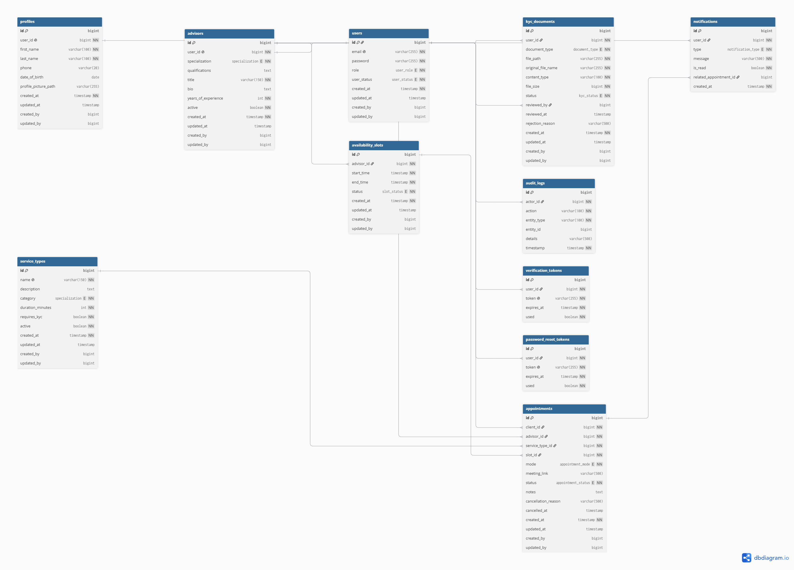

# FinConsult

## Project Information

**FinConsult** is a financial advisory platform that caters to customers, helping them make reasonable financial decisions. Clients find a financial advisor who matches what they need (loans, mortgages, investments, retirement, insurance, business banking or general advice), book an available time slot, and meet the advisor. Advisors manage their own availability and appointments, and administrators look after users, KYC documents and the audit trail.

### Application purpose

Booking a financial consultation normally means phone calls and back-and-forth scheduling, and services that involve moving money require identity checks first. FinConsult puts the whole flow in one secure REST API: availability, booking, identity (KYC) verification, notifications and accountability.

### Main features

**Accounts & security**
* Registration with email verification (unverified users cannot log in)
* JWT login, forgot-password email and change-password (BCrypt hashed passwords)
* Three roles that really gate behaviour: `CLIENT`, `ADVISOR`, `ADMIN`
* Rate limiting on login, registration, forgot-password and reset-password (5 requests per minute per IP, `429` with `Retry-After`)
* Soft delete: admins deactivate users and advisors (`INACTIVE`), which blocks login and cancels their appointments instead of deleting rows
* User profile with profile picture upload (JPEG / PNG)

**Booking workflow**
* Advisors publish availability slots; clients book them and cannot book a slot that is already taken (no double booking)
* The advisor must match the service's required specialty (General advisors can take any service)
* Services that move money (investments, loans, mortgages, business banking) require an **approved KYC document** of the right type
* Appointment statuses with enforced transitions: a booking starts as `PENDING`, the advisor moves it to `CONFIRMED`, and it can end as `CANCELLED` or `NO_SHOW` (a cancelled or no-show appointment cannot be cancelled again)
* Cancelling less than 24 hours before the appointment adds a strike to the client; 3 strikes blacklists the client
* Advisors can mark a no-show (only after the appointment has started plus 20 minutes); admins can excuse a no-show, which recalculates the strikes

**KYC**
* Clients upload identity documents (JPEG, PNG, PDF or DOCX, max 5 MB); admins approve or reject with a reason, and can download the file

**Real-time and email**
* In-app notifications for booking, confirmation, cancellation and no-show, pushed live over **Server-Sent Events**
* Emails for verification and password recovery

**API quality**
* Filtering, sorting and pagination (see below)
* Response DTOs and a central mapper (entities and password hashes are never exposed)
* Structured error responses from a global exception handler
* Audit log of important business and admin actions
* JPA auditing (`createdAt`, `updatedAt`, `createdBy`, `updatedBy`)
* Interactive Swagger / OpenAPI documentation
* Database seeding with demo data

### Filtering, sorting and pagination

| Resource | Endpoint | Filter / sort / paging |
|---|---|---|
| Appointments | `GET /appointments/mine` | `?status=PENDING` filters by status. `?sort=field,direction` sorts, allowed fields: `createdAt`, `status`, `slot.startTime`. Defaults to `createdAt` descending |
| Advisors | `GET /advisors` | `?specialty=MORTGAGES` filters by specialty. Without it, all active advisors are returned |
| Audit logs (admin) | `GET /admin/logs` | `?action=APPOINTMENT_CANCELLED` filters by action, `?page=0&size=20` paginates |
| KYC documents (admin) | `GET /kyc` | `?status=PENDING` (default) and `?documentType=NATIONAL_ID` filter, `?page=0&size=20` paginates |

Examples:

```
GET /appointments/mine?status=CONFIRMED&sort=slot.startTime,asc
GET /advisors?specialty=INVESTMENTS
GET /admin/logs?action=ADVISOR_CREATED&page=0&size=10
GET /kyc?status=PENDING&documentType=INCOME_PROOF
```

An invalid value, for example `?status=BANANA`, returns `400 Bad Request`.

## Technologies

* Java 17
* Spring Boot 4.1.1 (embedded Tomcat)
* Spring Security + JWT (jjwt)
* Spring Data JPA / Hibernate
* PostgreSQL
* Maven
* Bean Validation (`jakarta.validation`)
* Bucket4j (rate limiting)
* Server-Sent Events (`SseEmitter`) for real-time notifications
* Spring Mail (SMTP)
* springdoc-openapi (Swagger UI / OpenAPI)
* Lombok
* Git / GitHub

## Architecture

The application follows a layered architecture. Each layer only talks to the one below it.

```
Controller  ->  Service  ->  Repository  ->  PostgreSQL
(HTTP, DTOs)   (business rules)  (Spring Data JPA)
```

| Package | Responsibility |
|---|---|
| `controller` | REST endpoints, request validation, role checks (`@PreAuthorize`), Swagger annotations |
| `service` | All business rules: booking, cancellation and strikes, KYC, notifications, audit logging, file storage, email |
| `repository` | Spring Data JPA repositories |
| `model` | JPA entities (extend `BaseEntity` for timestamps and auditing), enums, `request` and `response` DTOs |
| `mapper` | `ResponseMapper`, the single place that converts entities to response DTOs |
| `security` | JWT filter and utilities, Spring Security configuration, rate-limit filter, auditor provider for `createdBy` / `updatedBy` |
| `exception` | Custom exceptions and the `GlobalException` handler that returns a consistent error body |
| `event` | Notification events and the listener that pushes them to SSE subscribers after the transaction commits |
| `config` | OpenAPI configuration and the development data seeder |

**Main entities:** `User`, `Profile`, `Advisor`, `ServiceType`, `AvailabilitySlot`, `Appointment`, `KycDocument`, `Notification`, `AuditLog`, `VerificationToken`, `PasswordResetToken`.

**Roles**

| Role | Can do |
|---|---|
| `CLIENT` | Register, manage own profile, upload KYC, browse advisors and slots, book and cancel own appointments, receive notifications |
| `ADVISOR` | Manage own slots and details, confirm appointments, mark no-shows, cancel own appointments |
| `ADMIN` | Create advisors, deactivate users and advisors, review KYC, excuse no-shows, view audit logs |

## General Approach

I started from the data model and the booking rules rather than from the endpoints. FinConsult is a booking system, so the core question was how to guarantee that a time slot can only be reserved once, and what has to be true before a client may reserve it (an active advisor, a matching specialty, and an approved KYC document for services that involve money). Those rules live in the service layer so the controllers stay thin. The project was built incrementally on feature branches: models, JWT authentication, role-based access, services, availability slots, email verification, no-show tracking, notifications, then KYC, auditing, filtering and sorting, response DTOs and API documentation.

Security is applied at several layers. Spring Security with a stateless JWT filter protects every route except registration, login, forgot-password and email verification. Roles are enforced with `@PreAuthorize`, and ownership is checked in the services (for example, only the two parties of an appointment can cancel it). Entities are never returned directly: services return response DTOs built by one central mapper, so the password hash and internal fields never leave the API. Errors go through one global exception handler so clients always receive the same structure.

Real-time notifications are saved as `Notification` records and then pushed over Server-Sent Events. The push happens in an `AFTER_COMMIT` event listener, so a client is never told about something that was rolled back. The audit log records who did what (for example, cancellations and admin actions) in a separate table, while JPA auditing adds `createdBy` and `updatedBy` columns to the entities.

## User Stories

[View the user stories on Github Project]
(https://github.com/users/aaldaka/projects/3)

## ERD



## Planning

[View the project plan on Github Project]
(https://github.com/users/aaldaka/projects/3)

## API Documentation

Interactive documentation is generated with Swagger / OpenAPI. With the app running:

* Swagger UI: http://localhost:8080/swagger-ui/index.html
* OpenAPI JSON: http://localhost:8080/v3/api-docs

To try protected endpoints: call `POST /auth/login`, copy the `token` from the response, click **Authorize** and paste the token (without the word `Bearer`).

### Endpoint reference

| Request Type | URL | Functionality | Access |
|---|---|---|---|
| POST | `/auth/register` | Register a new client account | Public |
| GET | `/auth/verify-email?token=` | Verify email address | Public |
| POST | `/auth/login` | Log in and receive a JWT | Public |
| POST | `/auth/forget-password` | Request a password reset email | Public |
| POST | `/auth/reset-password` | Set a new password using the emailed reset token | Public |
| POST | `/auth/change-password` | Change own password | Private |
| GET | `/service-types` | List the available consultation services | Private |
| GET | `/profile/me` | Get own profile | Private |
| PATCH | `/profile/me` | Update own profile | Private |
| POST | `/profile/me/picture` | Upload or replace profile picture | Private |
| GET | `/advisors` | List active advisors (`?specialty=`) | Private |
| GET | `/advisors/{id}` | Get an advisor | Private |
| PATCH | `/advisors/me` | Update own advisor details | Advisor |
| GET | `/slots/advisor/{advisorId}` | List an advisor's available slots | Private |
| GET | `/slots/mine` | List own slots | Advisor |
| POST | `/slots` | Create an availability slot | Advisor, Admin |
| DELETE | `/slots/{id}` | Delete an unbooked slot | Advisor |
| POST | `/appointments/book/{slotId}` | Book a slot for a service type | Client |
| GET | `/appointments/mine` | List own appointments (`?status=`, `?sort=`) | Private |
| PATCH | `/appointments/{id}/confirm` | Confirm a pending appointment | Advisor |
| PATCH | `/appointments/{id}/cancel` | Cancel an appointment (late cancel adds a strike) | Private (appointment parties) |
| PATCH | `/appointments/{id}/no-show` | Mark the client as a no-show | Advisor |
| PATCH | `/appointments/{id}/excuse` | Excuse a no-show and recalculate strikes | Admin |
| POST | `/kyc` | Upload a KYC document | Client |
| GET | `/kyc/me` | List own KYC documents | Client |
| GET | `/kyc` | List KYC documents (`?status=`, `?documentType=`, `?page=`, `?size=`) | Admin |
| PATCH | `/kyc/{id}/approve` | Approve a KYC document | Admin |
| PATCH | `/kyc/{id}/reject` | Reject a KYC document with a reason | Admin |
| GET | `/kyc/{id}/download` | Download a KYC document file | Admin |
| GET | `/notifications/mine` | List own notifications | Private |
| GET | `/notifications/mine/unread` | List own unread notifications | Private |
| PATCH | `/notifications/{id}/read` | Mark a notification as read | Private |
| GET | `/notifications/stream` | Subscribe to real-time notifications (SSE) | Private |
| POST | `/admin/advisors` | Create an advisor account | Admin |
| PATCH | `/admin/users/{id}/deactivate` | Deactivate a user and cancel their appointments | Admin |
| PATCH | `/admin/advisors/{id}/deactivate` | Deactivate an advisor (reason required) | Admin |
| GET | `/admin/logs` | List audit logs (`?action=`, `?page=`, `?size=`) | Admin |

"Private" means any logged-in user with a valid JWT.

### Error responses

Errors share one structure.

```json
{
  "timestamp": "2026-10-07T14:56:30",
  "status": 404,
  "error": "NOT_FOUND",
  "message": "Appointment not found",
  "path": "/appointments/42/confirm"
}
```

### Real-time notifications (SSE)

1. Log in and copy the JWT.
2. Open a connection with the token in the `Authorization: Bearer <token>` header, for example in Postman: `GET http://localhost:8080/notifications/stream`.
3. In another request, trigger an event (for example, book or confirm an appointment as the other user).
4. The connected client receives the notification immediately, without polling.

## Installation

**Requirements:** Java 17, Maven (or the included `mvnw` wrapper), PostgreSQL.

1. **Clone the repository**
   ```bash
   git clone 
   <https://github.com/aaldaka/Project-2-FinConsult.git> 
   cd Project-2-FinConsult
   ```
2. **Create the PostgreSQL database**
   ```sql
   CREATE DATABASE finconsult_demo;
   ```
   Tables are created automatically on the first run (`spring.jpa.hibernate.ddl-auto=update`).
3. **Configure the application.** The default profile is `dev` (`application-dev.properties`). Set the database username and password there to match your local PostgreSQL.
4. **Set environment variables** (they are not stored in the code):

   | Variable | Purpose |
   |---|---|
   | `JWT_SECRET` | Secret used to sign JWTs (use a long random string) |
   | `MAIL_USERNAME` | SMTP account that sends verification and reset emails |
   | `MAIL_PASSWORD` | SMTP password or app password |

   Example (PowerShell): `$env:JWT_SECRET="a-long-random-string"`. Without mail credentials the app still runs, but verification and password-reset emails cannot be sent. Use a seeded account (below) to log in instead.
5. **Seed the database.** Nothing to run. With the `dev` profile the seeder runs automatically on startup. It only adds data that does not exist yet, so restarting never creates duplicates. It creates:
   * 7 service types (one per specialty; the money-related ones require KYC)
   * 1 admin, 8 advisors (one per specialty, plus a second General advisor) and 4 clients
   * availability slots for the next five working days, approved KYC documents for one client, and sample appointments
6. **Start the application**
   ```bash
   ./mvnw spring-boot:run
   ```
   The API is available at http://localhost:8080.
7. **Access Swagger / OpenAPI:** http://localhost:8080/swagger-ui/index.html

### Frontend (React)
The `frontend` folder holds a React app (TypeScript, Vite, Tailwind, TanStack Query) that consumes the REST API.

**Requirements:** Node.js 20.19 or newer.

```bash
cd frontend
npm install
npm run dev
```
Open http://localhost:5173. The backend must be running on http://localhost:8080 (CORS allows only the frontend's origin). Log in with one of the demo accounts below.

### Demo accounts (development only)

All seeded accounts use the password `Password123!`.

| Role | Email |
|---|---|
| Admin | `abdulaziz.alkhalifa@finconsult.com` |
| Advisor (Investments) | `nasser.alkooheji@finconsult.com` |
| Advisor (General) | `reem.almannai@finconsult.com` |
| Client (KYC approved) | `maryam.alhammadi@example.com` |
| Client | `hamad.alansari@example.com` |

## Unsolved Problems

* **Uploaded files are stored on the local disk** (`uploads/`). A production setup would use object storage.
* **No refresh tokens.** A JWT is valid until it expires and then the user must log in again. Blacklisted clients maintain their tokens.
* **Seeded KYC documents are placeholders.** They are approved records without real files, so they cannot be downloaded.

## Major Challenges

* **Preventing double booking and keeping slots consistent.** A booking has to reserve the slot and create the appointment together, and a cancellation has to release the slot again. Both run in a single transaction in the service layer, and a slot's status is checked before it is booked.

* **Entities leaked through the API.** Early endpoints returned entities, which exposed internal fields. I introduced response DTOs and one central mapper so every service returns the same safe shapes.
* **A query parameter that silently did nothing.** A KYC filter parameter was ignored because Spring binds an unannotated enum parameter by variable name. Annotating it explicitly and adding a handler for invalid enum values (returning `400`) fixed it.


## Future Improvements

* Major banks and other entities as clients
* Payment gateway for paid consultations
* Advisor applications, with their credentials and qualifications verified
* AI assistant to help with inquiries. If a general advisor is unavailable, the assistant steps in. It detects sensitive information such as salary or ID numbers and does not save the session data
* Cleaner code approach when it comes to separation of concerns
* Change `createdBy` and `updatedBy` to display the actor's name instead of the their ID for better clarity

## Resources

| Resource | URL | Used for |
|---|---|---|
| Baeldung: Rate Limiting with Bucket4j | https://www.baeldung.com/spring-bucket4j | Rate limiting on public endpoints |
| Baeldung: Server-Sent Events in Spring | https://www.baeldung.com/spring-server-sent-events | Real-time notifications |
| Spring Data `PageRequest` API docs | https://docs.spring.io/spring-data/commons/docs/current/api/org/springframework/data/domain/PageRequest.html | Pagination |
| Baeldung: Sorting with Spring Data | https://www.baeldung.com/spring-data-sorting | Sorting |
| springdoc-openapi | https://springdoc.org | Swagger / OpenAPI documentation |
| dbdiagram.io | https://dbdiagram.io | Entity Relationship Diagram |
